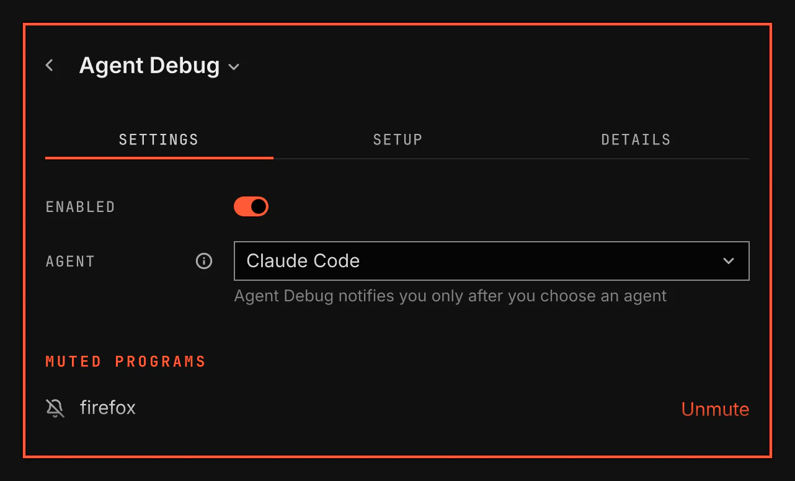

# Agent Debug

Agent Debug tells you when a program crashes or a VGS setup task fails, and offers Diagnose. Diagnose opens the AI agent you choose with the facts of the failure, so you get an explanation without searching logs yourself.

## Features

- A notification when one of your programs crashes, with Diagnose and Mute.
- A notification when a VGS setup task, the install or update of a plugin's tools, fails, with Diagnose.
- Diagnose for a failed sync job, from Send to agent in Local Sync.
- Diagnose opens Claude Code, Codex, Copilot, Pi or OpenCode in a floating terminal. The agent asks you before it runs a command.
- With Jarvis, Diagnose opens an editable message in its console. Send or Enter sends it; Shift+Enter adds a line.
- At most one notification for each program or task in a minute.
- Muted programs on the Settings tab, each with Unmute.

## How it works

Agent Debug notifies you only after you choose an agent on its Settings tab. It checks your programs' crash records and failed VGS tool installs and updates.

Diagnose gives the agent the facts of the failure and asks it to read the records on this computer. It asks for an explanation without changes, with proved facts kept apart from possible causes.

Jarvis cannot read the system crash store, journal or package logs through its command sandbox. It can use the supplied failure facts and readable files in your home outside protected folders. It states what it cannot prove rather than asking for more access.

At the end of a crash diagnosis the agent asks whether to mute that program, and mutes it only when you say yes.

## Setup

Choose an agent on the Settings tab. The list shows installed terminal agents and available message receivers. A saved unavailable choice stays selected. Diagnose explains the cause and offers Claude Code or Codex for that failure without changing your saved choice. The Tools step on the Setup tab offers to install missing tools.

| Setting | What it changes |
| --- | --- |
| Agent | The agent Diagnose opens. Until you choose one, Agent Debug shows no notification. |
| Muted programs | The programs whose crashes do not notify you. Unmute asks before it removes a program from the list. |
