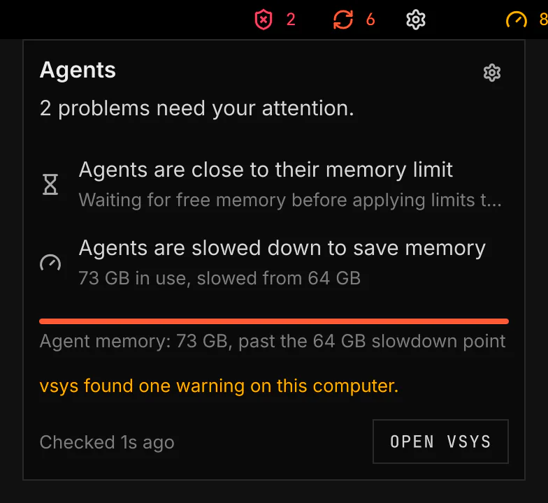

# Agent Warden

Agent Warden shows whether your AI coding agents stay within their memory and process limits. It is for people who run several agents on one computer. [vsys](https://github.com/vanillagreencom/vsys) provides the warden it reads.



## Features

- A shield in the bar that shows the agents' state, with the number of running agents or problems beside it.
- A panel that describes the state in one sentence, lists the most serious problems first and shows how close the agents' memory is to the point where they slow down.
- Open vsys in the panel opens the vsys dashboard.
- A notification when an agent nears a limit, when agents wait for memory, when the warden cannot apply a limit or cleans up after an agent, and when it stops checking.
- `SUPER+CTRL+Y` opens and closes the panel. The Keys row on the plugin's Settings page changes it.

## How it works

Agent Warden only reports. The vsys warden checks your agents and tries to move them back into their limits on its own schedule, so it keeps working when VGS restarts or stops. Agent Warden reads what the warden found and shows it.

## Setup

While a setup step is needed, the plugin's Setup tab and its panel show it as a button. Install vsys opens the install notice for vsys. Set up opens a floating terminal that starts the warden's checks.

<details><summary>Show command</summary>

```bash
vsys warden install
```

</details>

| Setting | What it changes |
| --- | --- |
| Show count | Shows the number of running agents or problems on the corner of the shield. |
| Hide when idle | Hides the shield when no agents run and nothing needs attention. |
| Notifications | Alerts for problems, all events or none. |

[developer.md](developer.md) states each state, notification and IPC function.
