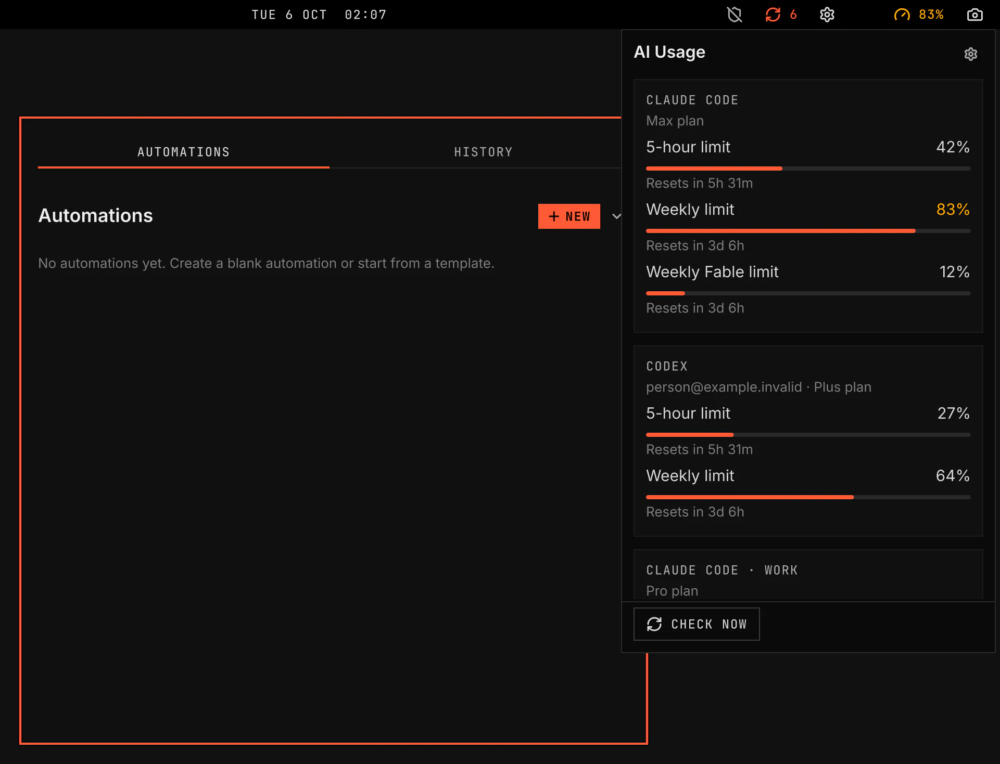

# AI Usage

AI Usage shows how much of your Claude Code, Codex and Copilot plan limits you have used. It reads each tool's own sign-in, so it needs no API key.



## Features

- One number for your visible accounts in the bar: by default the highest share of a plan limit used. It turns to the warning colour at 80 % used.
- A card for each visible account, with the provider and the account's email. Copilot gives no email, so its card shows the GitHub login. An account with no email or login shows no account line.
- Sort cards by provider, email or the most room left in their limits. Accounts with no reported limit come last when sorted by room.
- Provider marks identify the cards. An API account carries an [API] chip. Codex API accounts show that they have no plan limits.
- Limit values use the theme's success, warning and danger colours as their used share grows.
- Each card shows the 5-hour limit after the other limits, and only for an account whose plan has one. When the weekly limit is at 100 %, the card shows only the weekly limit.
- A row for each credit the provider reports, in both views, after the limits: a Claude Code credit under the title Claude sends, and the Codex credit balance. Each row shows the amount the provider reports and the time left until its reset time.
- A compact panel view with one line for each limit and the time left until it resets.
- A full panel view with meters and provider details when the provider sends them.
- An account that has had no use yet says so instead of showing 0 %. A limit that starts with your first message reads Not started until then.
- The calendar button left of the Settings gear shows the reset calendar above the cards. It lists the next seven days that have a reset. Under each day are the accounts whose weekly limit, or Copilot's monthly allowance, resets that day, with the reset time and the share used. The 5-hour limit is not listed. The calendar stays open until you close the panel.
- The panel grows to half the screen height before it scrolls.
- Copilot AI credits per account, with the amount used this month and the renewal date.
- Claude Code extra usage in the full view when Claude reports it.
- Every Claude Code, Codex and Copilot account on this computer.
- Filters for providers and hidden accounts.
- The bar item stays hidden until you sign in to one of the visible tools. A click opens the panel.
- When a check fails, the panel keeps the last figures and says that they may be old.
- Last checked beside Check now shows how long ago the shared check completed. When Claude turns away a usage read, the card keeps the last figures. After a limit resets, the card says that the kept figures may be old.
- AI Usage never changes a tool's sign-in.

## Setup

| Setting | What it changes |
| --- | --- |
| Check interval | Time between usage checks. Check now in the panel starts a check at once. |
| View | Compact shows account identity and limit lines. Full adds meters and provider details. |
| Sort accounts | Provider, Email or Most room first. |
| Bar number | How the bar figures one number from each account's highest limit: Average, Most left or Most used. An account with no limits is left out. |
| Bar shows | Used shows the share used. Left shows the share that is left. |
| Colour by usage | Shows the bar number in the warning colour from 80 % used, whichever share it shows. |
| Providers | Show or hide Claude Code, Codex and Copilot in the panel and bar total. |
| Hidden accounts | Hide selected accounts from the panel and bar total. The choices are the signed-in accounts, each shown as its provider and email, or the GitHub login for Copilot. An account that has neither shows the provider alone. A new item reads Choose an account and hides nothing until you choose one. A hidden account that is later signed out stays in the list and shows as unavailable. |

Sign in for Claude Code and Codex is on the Setup tab, as optional steps, and opens the tool's own sign-in in a terminal window.

When a Claude Code or Copilot sign-in has expired, open that tool once to refresh it.

<details><summary>Show command</summary>

```bash
claude auth login
codex login
```

</details>

### AI Gateway credits

Turn on AI Gateway credits in Settings. Select Get AI Gateway key on the Details tab to open Vercel. In the dashboard, open AI Gateway, then API keys, then Create key. The key unlocks AI Gateway credit figures.

On the Settings tab, under AI Gateway credits, select Add key on the AI Gateway row. Paste the key into the masked field. VGS stores it in your keyring. Replace beside a stored key replaces it, and Remove removes it. A key or a switch change checks the figures at once. With the switch off, VGS reads no AI Gateway key and calls no AI Gateway API.

## Licence

The Claude, GitHub Copilot and Vercel marks come from [Simple Icons 16.17.0](https://github.com/simple-icons/simple-icons/tree/16.17.0), under [CC0-1.0](https://github.com/simple-icons/simple-icons/blob/16.17.0/LICENSE.md). The source files are [Claude](https://github.com/simple-icons/simple-icons/blob/16.17.0/icons/claude.svg), [GitHub Copilot](https://github.com/simple-icons/simple-icons/blob/16.17.0/icons/githubcopilot.svg) and [Vercel](https://github.com/simple-icons/simple-icons/blob/16.17.0/icons/vercel.svg). The cards draw these marks in the theme's text colour.

The OpenAI mark for Codex comes from [lobe-icons v5.23.0](https://github.com/lobehub/lobe-icons/tree/v5.23.0), under [MIT](https://github.com/lobehub/lobe-icons/blob/v5.23.0/LICENSE). The source file is [OpenAI](https://github.com/lobehub/lobe-icons/blob/v5.23.0/packages/static-svg/icons/openai.svg). Its copyright and permission notice are included with the bundled mark in [UsageView.js](UsageView.js).
