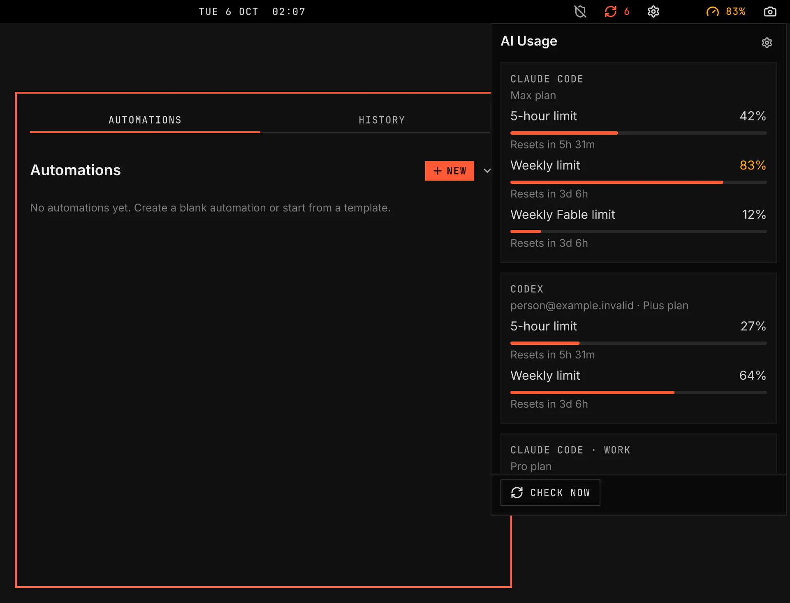

# AI Usage

AI Usage shows how much of your Claude Code, Codex and Copilot plan limits you have used. It reads each tool's own sign-in, so it needs no API key, and it never changes that sign-in.



## Features

- One number in the bar for your accounts, with optional warning colour from 80 % used.
- A card for every Claude Code, Codex and Copilot account on this computer, named by its email or login, with each limit and the time left until it resets.
- Credits the providers report: Claude Code extra usage, the Codex credit balance and Copilot AI credits.
- A compact view with one line per limit, and a full view with meters and provider details.
- A reset calendar of the next seven days.
- Sorting, provider filters and hidden accounts.
- Refresh on a card's More actions menu checks every account again, as Check now does.
- Hide on a card's More actions menu removes that account from the cards and the reset calendar at once. The panel stays open.
- When a check fails, the panel keeps the last figures and says they may be old.
- Optional AI Gateway credits from Vercel.

## Setup

Sign in for Claude Code and Codex is an optional step on the Setup tab. It opens the tool's own sign-in in a terminal window. When a Claude Code or Copilot sign-in has expired, open that tool once to refresh it.

<details><summary>Show command</summary>

```bash
claude auth login
codex login
```

</details>

| Setting | What it changes |
| --- | --- |
| Check interval | Time between usage checks. Check now in the panel checks at once. |
| View | Compact or Full. |
| Bar number | How the bar figures one number from your accounts: Average, Most left or Most used. |
| Bar shows | The share used or the share left. |
| Colour by usage | Uses the warning colour from 80 % used. |
| Providers | Show or hide Claude Code, Codex and Copilot. |
| Hidden accounts | Accounts left out of the panel, the reset calendar and the bar number. Hide on a card adds the account here. Remove the account from this list to show it again. |

### AI Gateway credits

Turn on AI Gateway credits in Settings. Select Get AI Gateway key on the Details tab to open Vercel. In the dashboard, open AI Gateway, then API keys, then Create key.

On the Settings tab, under AI Gateway credits, select Add key on the AI Gateway row and paste the key into the masked field. VGS stores it in your keyring. Replace and Remove beside a stored key change it. With the switch off, VGS reads no AI Gateway key and calls no AI Gateway API.

## Licence

The Claude, GitHub Copilot and Vercel marks come from [Simple Icons 16.17.0](https://github.com/simple-icons/simple-icons/tree/16.17.0), under [CC0-1.0](https://github.com/simple-icons/simple-icons/blob/16.17.0/LICENSE.md). The source files are [Claude](https://github.com/simple-icons/simple-icons/blob/16.17.0/icons/claude.svg), [GitHub Copilot](https://github.com/simple-icons/simple-icons/blob/16.17.0/icons/githubcopilot.svg) and [Vercel](https://github.com/simple-icons/simple-icons/blob/16.17.0/icons/vercel.svg). The cards draw these marks in the theme's text colour.

The OpenAI mark for Codex comes from [lobe-icons v5.23.0](https://github.com/lobehub/lobe-icons/tree/v5.23.0), under [MIT](https://github.com/lobehub/lobe-icons/blob/v5.23.0/LICENSE). The source file is [OpenAI](https://github.com/lobehub/lobe-icons/blob/v5.23.0/packages/static-svg/icons/openai.svg). Its copyright and permission notice are included with the bundled mark in [UsageView.js](UsageView.js).
