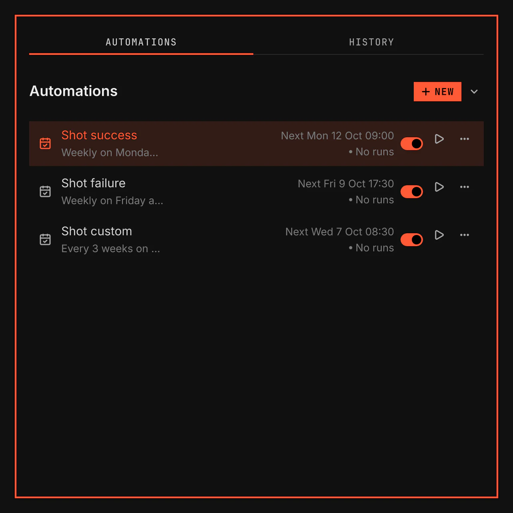

# Automations

Automations runs your commands on a schedule. It keeps each run's output and sends an alert when a run fails. It is for anyone who wants a backup, a sync or a script to run on its own.



## Features

- A window with the list of automations, an editor, a preview of the next runs and the history.
- Schedules: once, every day, weekdays, every week, every two weeks, a day of the month, a weekday of the month, a day of the year, or a custom every N days, weeks, months or years.
- Interval schedules: every N minutes or every N hours, such as every 10 minutes or every 2 hours. The runs start at midnight each day, so N divides an hour or a day.
- Schedule times can use your local time or UTC. Local time remains the default.
- An end: never, on a date, or after a number of runs. An interval schedule ends never or on a date.
- Per automation: paused or enabled, a multi-line shell command, a timeout, a working directory, catch-up of runs missed while the computer was off, and a notification for every start and finish.
- Each command runs in your login shell, so it finds what your terminal finds.
- Run now, a history of every run with its outcome and transcript, and clearing one automation's history or all of it.
- A failed run sends a notification. A click on it opens the transcript. When more runs fail after it, that one notification shows how many runs failed and since when, and the next run that succeeds replaces it with a recovered notification.
- A run continues when VGS closes.
- Turn on Needs internet in an automation’s Run settings to wait for internet access before it runs. Local commands start without this wait.
- A waiting run shows its due time and Cancel. If internet access cannot be checked, the row and editor explain why.

## Setup

The plugin ships with VGS and is enabled by default. It schedules runs through systemd. Where no systemd user manager answers, it uses your crontab instead.

Scheduled runs stop when you log out unless systemd keeps your user session running. Enable while logged out, an optional step on the plugin's Setup tab, and Run automations while logged out in the launcher open a floating terminal that asks, then turns that on.

<details><summary>Show command</summary>

```bash
loginctl enable-linger
```

</details>

| Setting | What it changes |
| --- | --- |
| Keep history | How long to keep each run's history and output, from 1 to 30 days. |

[developer.md](developer.md) states how a run works, the files and the plugin's command.
