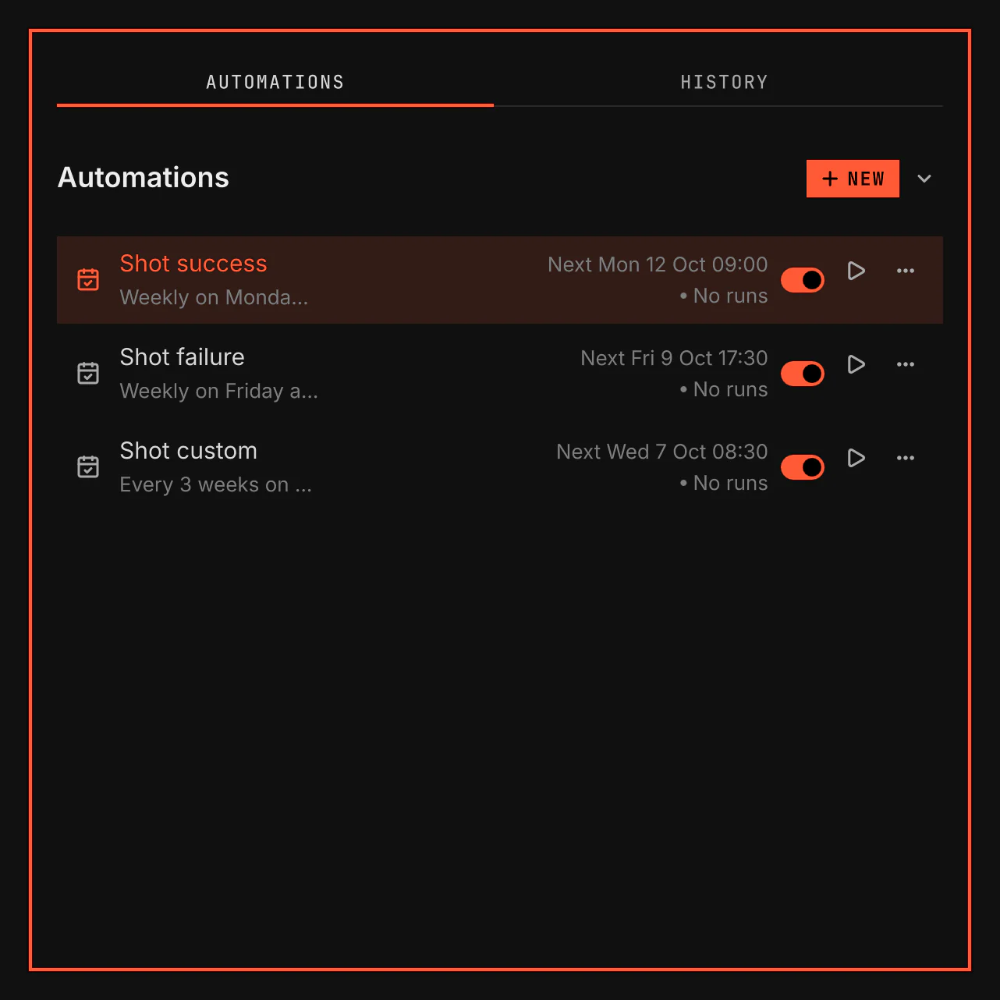

# Automations

Automations runs your commands on a schedule. It keeps each run's output and sends an alert when a run fails. It is for anyone who wants a backup, a sync or a script to run on its own.



## Features

- A window to write, schedule and preview your automations, with the history of every run.
- Schedules from once to every N minutes, hours, days, weeks, months or years, in local time or UTC.
- An end date, or for daily and longer schedules a number of runs.
- Per automation: a shell command, a timeout, a working folder and catch-up of runs missed while the computer was off.
- Run now, and the output of every run.
- A notification when a run fails and another when it recovers.
- Needs internet, on for a new automation, waits for internet access before a run. Turn it off for a local command.
- Runs continue when VGS closes.

## Setup

Automations ships with VGS and is on by default. With the system scheduler, scheduled runs stop when you log out unless you enable them while logged out. Runs scheduled through cron continue after logout.

To enable runs while logged out, select Enable while logged out on the plugin's Setup tab or Run automations while logged out in the launcher. Either opens a floating terminal that asks, then turns it on.

<details><summary>Show command</summary>

```bash
loginctl enable-linger
```

</details>

| Setting | What it changes |
| --- | --- |
| Keep history | How long to keep each run's history and output, from 1 to 30 days. |

[developer.md](developer.md) states how a run works, the files and the plugin's command.
