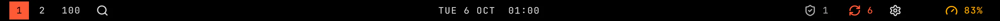

# Bar

The bar shows workspaces, the clock and plugin buttons at the top of each screen.

## Features

- One bar on each screen. Windows never sit under it.
- Workspace numbers, the focused one highlighted. A click focuses a workspace.
- A clock in the format you choose. A click opens a calendar, and a click on a day opens it in your web calendar.
- Three sections for plugin buttons. A section with more buttons than room scrolls with its < and > buttons or the mouse wheel.
- Separators and gaps: right-click an empty part of the bar and choose Add separator or Add gap.
- Hide top bar, in the launcher's Style menu, or `SUPER+SHIFT+SPACE` hides the bar and gives its space to windows, or shows it again. The Keys row on the plugin's Settings page changes the key.
- Colours, the font and sizes follow the theme.

## Setup

| Setting | What it changes |
| --- | --- |
| Clock format | How the clock shows the date and time. |
| Calendar | The web calendar a click on a day opens: Google Calendar, Outlook, or your own address with {year}, {month} and {day}. |
| Open with | The browser, or browser profile, that opens your calendar. |
| Hide top bar | Hides the bar on every screen. |

[developer.md](developer.md) states the configuration keys that place the built-ins and the plugin buttons.
