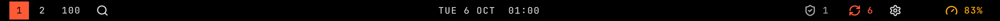

# Bar

The bar shows plugin widgets at the top of each screen.

## Features

- One bar on each screen. Windows never sit under it.
- Three sections for widgets such as the [clock](../vgs.clock/README.md) and [workspace numbers](../vgs.workspaces/README.md). A section with more widgets than room scrolls with its < and > buttons or the mouse wheel.
- Separators and gaps: right-click an empty part of the bar and choose Add separator or Add gap.
- Hide top bar, in the launcher's Style menu, or `SUPER+SHIFT+SPACE` hides the bar and gives its space to windows, or shows it again. The Keys row on the plugin's Settings page changes the key.
- Colours, the font and sizes follow the theme.

## Setup

| Setting | What it changes |
| --- | --- |
| Hide top bar | Hides the bar on every screen. |

[developer.md](developer.md) states the configuration keys that place the built-ins and the plugin buttons.
