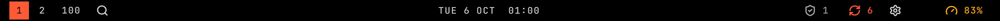

# Bar

The bar shows workspaces, the clock and plugin buttons at the top of each screen.

## Features

- One bar per screen, above windows, with space reserved so windows never sit under it.
- Workspaces: one number per workspace, lowest first, the focused one highlighted. A click focuses that workspace.
- The clock: the date and time in the preset or custom format you choose.
- A click on the clock opens a calendar under it, on this month with today marked. Left and Right, or the Previous month and Next month buttons, change the month. A click on a day opens that day in your web calendar, in the default browser or the browser profile Open with names; Enter opens today.
- Three sections for plugin buttons. Enabling a plugin on its Settings page places its button in the section the plugin chooses.
- A side section never draws over the clock. When its buttons do not fit, it shows the buttons nearest its screen edge, with a < or > button and a slight fade at each end that has more. Click < or >, or turn the mouse wheel over the section, to show more.
- Right-click an empty part of the bar and choose Add separator or Add gap to put a thin line or a little empty room where you clicked. Drag either to move it; right-click it and choose Remove separator or Remove gap to take it away.
- Colours, the font and every size follow the theme.
- Hide top bar, in the launcher's Style menu, turns on the Hide top bar setting: the bar hides on every screen and gives its space to windows. The row then reads Show top bar, which turns the setting off again.
- `SUPER+SHIFT+SPACE` turns the Hide top bar setting on or off the same way. The Keys row on the plugin's Settings page changes the key.
- Another program can hide the bar for a short time, for example a zoom mode. The Hide top bar setting does not show a bar that program hides. The bar shows again when that program shows it, or when the shell starts again.
- Only one bar is active at a time. Disabling it hides every plugin button until a bar is enabled again.

## Settings

| Setting | What it changes |
| --- | --- |
| Clock format | How the bar's clock shows the date and time. |
| Calendar | The web calendar a click on a day opens: Google Calendar, Outlook, or your own address with {year}, {month} and {day}. |
| Open with | The browser a click on a day opens your calendar in: the default browser, or one profile of Chromium, Google Chrome, Brave, Vivaldi or Microsoft Edge. The list shows the profiles of each of these browsers you have installed. |
| Hide top bar | Hide the bar on every screen and give its space to windows. |

[developer.md](developer.md) states the configuration keys that place the built-ins and the plugin buttons.
