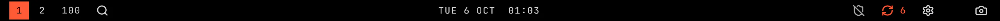
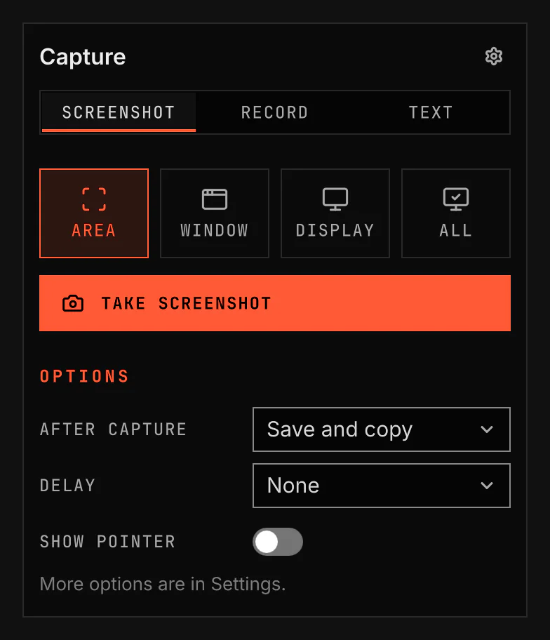

# Capture

Capture takes PNG screenshots. It can save them, copy them, or do both. It also records the screen and copies text from a selected area in the languages you choose.

## Features

- Screenshots of a display, an area, a window or all displays, with an optional delay and pointer.
- Save, copy, or both.
- Screen recording with desktop or microphone audio and an optional camera picture in the corner.
- Text recognition from a selected area, in one or more languages.
- A notification for each capture. Open and Edit start your own viewer, editor or player.
- A panel in the bar to choose and start a capture, and a bar indicator that stops a recording.
- Shortcuts: Print for a screenshot, `SUPER+SHIFT+S` for an area, `SUPER+SHIFT+R` for a recording, `SUPER+CTRL+PRINT` for text and `SUPER+CTRL+SHIFT+S` for the panel. The Keys row on the plugin's Settings page changes them.

## Setup

| Setting | What it changes |
| --- | --- |
| After capture | Save and copy, copy only, or save only. |
| Screenshot folder | Empty uses Screenshots in your Pictures folder. A custom folder is an absolute path or starts with `~/`. |
| Recording folder | Empty uses Screencasts in your Videos folder. |
| Audio | None, desktop, microphone, or desktop and microphone. |
| Text languages | The languages Capture reads. English comes with Capture. Install languages adds the others you choose. |
| Image viewer, Image editor, Video player | The program each notification button starts. imv, Satty and mpv are the defaults. |

Every saved recording puts its file link on the clipboard, which replaces what the clipboard held. Recording needs gpu-screen-recorder, which the Arch and NixOS packages provide. A missing tool opens the install notice for the action that needs it.

[developer.md](developer.md) states each action and its IPC name.
