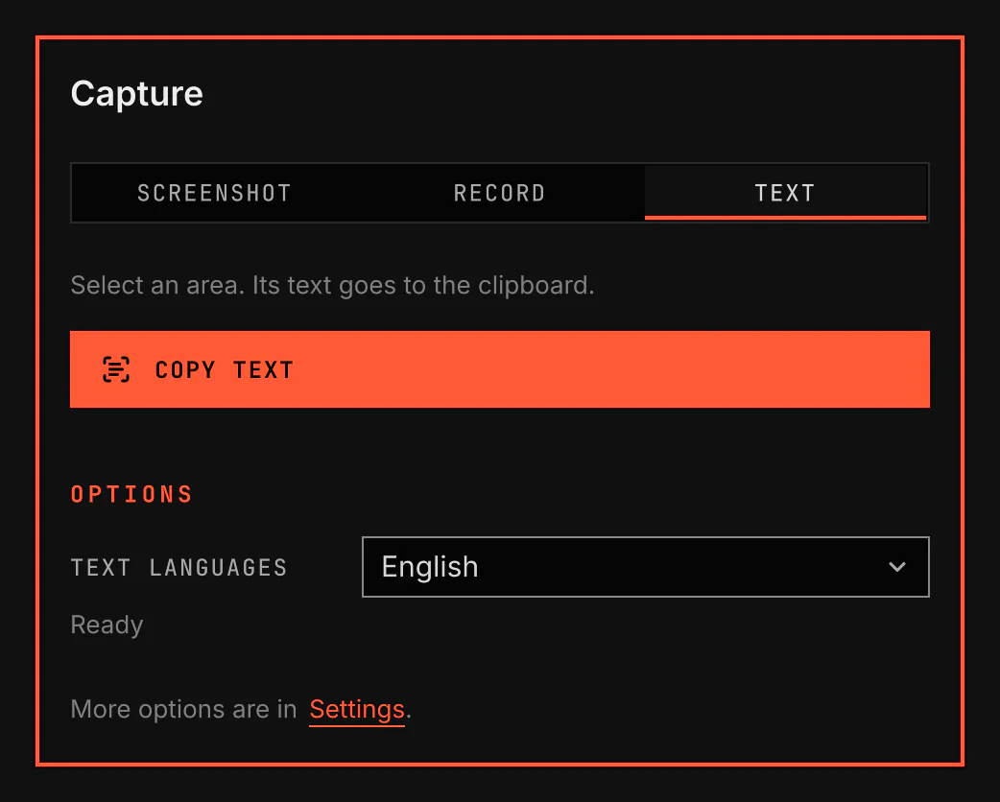

# Capture

Capture takes PNG screenshots. It can save them, copy them, or do both. It also records the screen and copies text from a selected area in the languages you choose.

## Features

- Screenshots of a display, an area, a window or all displays, with an optional delay and pointer.
- Save, copy, or both.
- Screen recording with desktop or microphone audio and an optional camera picture in the corner.
- Text recognition from a selected area, in one or more languages.
- A screen sharing picker: when an app asks to share your screen, you choose a display, a window or an area while a live preview shows it. VGS sets the picker up for you, once no app shares your screen. Turning Capture off gives screen sharing its own picker back once no app shares your screen, and a notification says so when it cannot.
- A notification for each capture. Open and Edit start your own viewer, editor or player.
- A window to choose and start a capture, opened from the bar, and a bar indicator that stops a recording.
- Shortcuts: Print for a screenshot, `SUPER+CTRL+S` for an area, `SUPER+SHIFT+R` for a recording, `SUPER+CTRL+PRINT` for text and `SUPER+CTRL+SHIFT+S` for the Capture options. The Keys row on the plugin's Settings page changes them.

## Setup

Open Plugin settings from the launcher and choose Capture. On Settings, choose whether screenshots save, copy or do both. Leave the folders empty to use Screenshots in your Pictures folder and Screencasts in your Videos folder. A custom folder is an absolute path or starts with `~/`.

Choose recording audio and a camera on the same page. Text languages selects the languages Capture reads; use Install languages on Setup for missing language data. Open with chooses the viewer, editor and player used by capture notifications.

Every saved recording puts its file link on the clipboard, which replaces what the clipboard held. A missing tool opens the install notice for the action that needs it.

For capture actions in scripts, see the [developer reference](developer.md).
