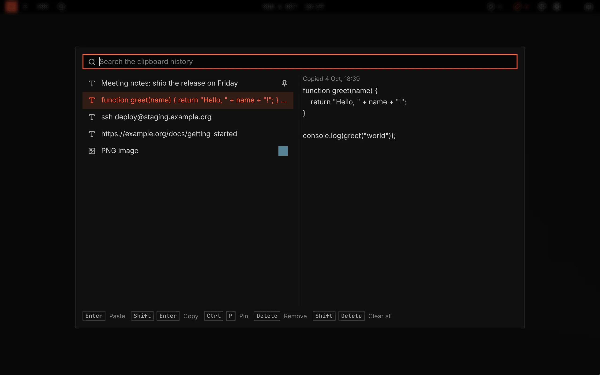

# Clipboard

Clipboard keeps what you copy. Open the history with `SUPER+CTRL+V`, find an earlier copy and paste it again. `SUPER+C`, `SUPER+V` and `SUPER+X` copy, paste and cut in a terminal, an application and a VGS field.

## Features

- A history of your last 500 text and image copies, kept after a restart.
- Type to find an entry. "image" or a type such as "png" finds images.
- Enter pastes the entry into the application you work in. Shift+Enter puts it on the clipboard only.
- Ctrl+P pins or unpins an entry. Delete removes one, and Shift+Delete clears unpinned entries. Pins are kept first when the history fills; if all 500 entries are pinned, the oldest goes.
- `SUPER+C`, `SUPER+V` and `SUPER+X` work in a terminal, an application and a VGS field. A terminal has no cut.

## Setup

Clipboard ships with VGS and is on by default. It saves copies to disk, so the history stays after a restart. A copy that the source app marks as secret is never saved, but a password copied from an app that does not mark it is saved like any other copy. To stop recording, open Plugins, select Clipboard in the plugin list and turn the plugin off; the history you have stays. To clear unpinned entries, press Shift+Delete in the Clipboard list and answer the question. Remove a pinned entry with Delete.

The Keys rows on the plugin's Settings page change the four keys. The Tools step on its Setup tab lists the tools Clipboard needs, and Review all missing or outdated tools opens the notice that installs them.

In a terminal, the keys work with kitty, Ghostty, foot and Alacritty at their default settings. When VGS cannot identify the application, it sends no key and shows a message.

[developer.md](developer.md) states what is recorded, where it is kept and the plugin's IPC functions.
