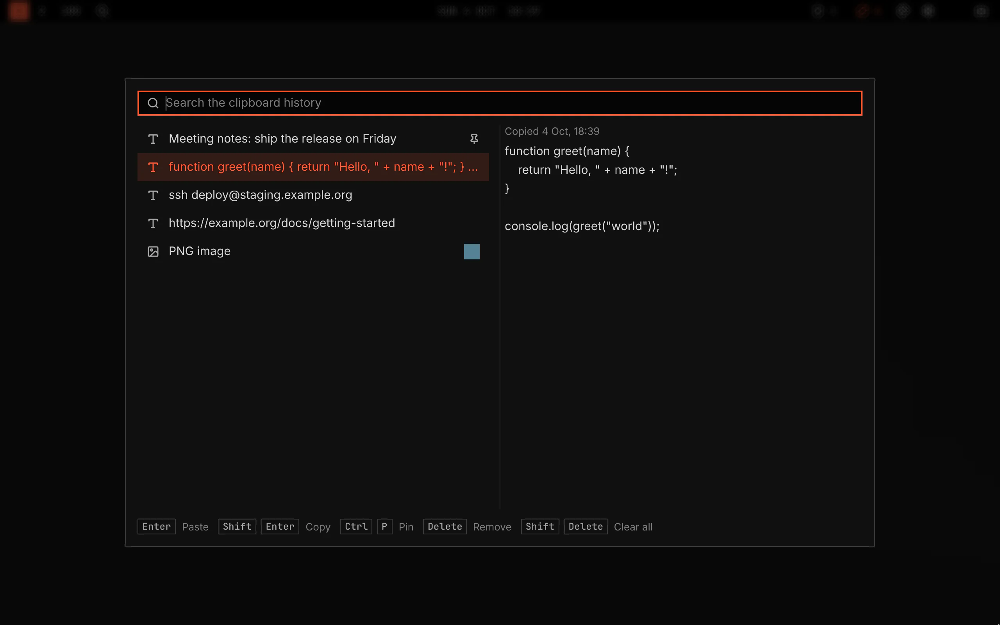

# Clipboard

Clipboard keeps what you copy. Open the history with `SUPER+CTRL+V`, find an earlier copy and paste it again. `SUPER+C`, `SUPER+V` and `SUPER+X` copy, paste and cut in a terminal, an application and a VGS field.

## Features

- A history of your last 500 text and image copies. It stays after a restart.
- Type to find an entry. Find an image entry by "image" or by its type, such as "png".
- Enter pastes the selected entry into the application you work in. Shift+Enter puts it on the clipboard only.
- Ctrl+P pins an entry. A pinned entry stays first, and stays when you clear the history or the history is full.
- Delete removes an entry. Shift+Delete clears the history after a question.
- A copy that a password manager marks as secret is never recorded.
- `SUPER+C` copies, `SUPER+V` pastes and `SUPER+X` cuts. The same three keys work in a terminal, in an application and in a VGS field such as the launcher search. A terminal has no cut.

## Setup

Clipboard ships with VGS and is on by default. It saves every copy to disk, so the history stays after a restart. A copy that the source app marks as secret is never saved, but a password copied from an app that does not mark it is saved like any other copy. To stop recording, open Plugins, select Clipboard in the plugin list and turn the plugin off; the history you have stays. To clear the history, press Shift+Delete in the Clipboard list and answer the question. Pinned entries stay.

The Keys rows on the plugin's Settings page change `SUPER+CTRL+V`, `SUPER+C`, `SUPER+V` and `SUPER+X`. The Tools step on its Setup tab lists the tools Clipboard needs, and Review all missing or outdated tools opens the notice that installs them.

In a terminal, the copy and paste keys send Ctrl+Shift+C and Ctrl+Shift+V. kitty, Ghostty, foot and Alacritty copy and paste with those keys at their default settings.

[developer.md](developer.md) states what is recorded, where it is kept and the plugin's IPC functions.
