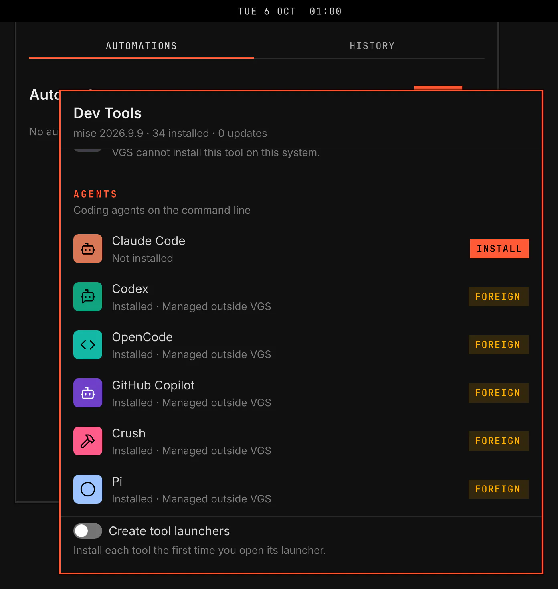

# Dev Tools

Dev Tools installs, updates, pins and removes developer tools: coding agents, apps, command-line tools, languages, editors, databases and terminals. Its Catalog page also shows the VGS version and the tools VGS is missing.



## Features

- A Catalog page with search, Installed, Updates and Not installed filters, and one row per tool.
- Install, Update, Remove, Version, Pin, Unpin and Roll back actions. Each change runs in a floating terminal.
- Update all updates unpinned tools only.
- A Dev Tools launcher category lists catalog rows and installs a missing tool before it starts it.
- A tool that something outside VGS provides shows Managed outside VGS and still starts from `PATH`.
- mise manages the tools. While it is missing, select Review all missing or outdated tools on the Tools step of the Setup tab.

<details><summary>Show command</summary>

```bash
vgshell pkg run install mise
```

</details>

## Setup

| Setting | What it changes |
| --- | --- |
| Show full catalog in launcher | Shows Dev Tools catalog rows in launcher search. |
| Add tool commands to the terminal | Writes commands into `~/.local/bin` and installs a tool the first time you run one. |

[developer.md](developer.md) states the catalog, the engine, the window and the launchers.
