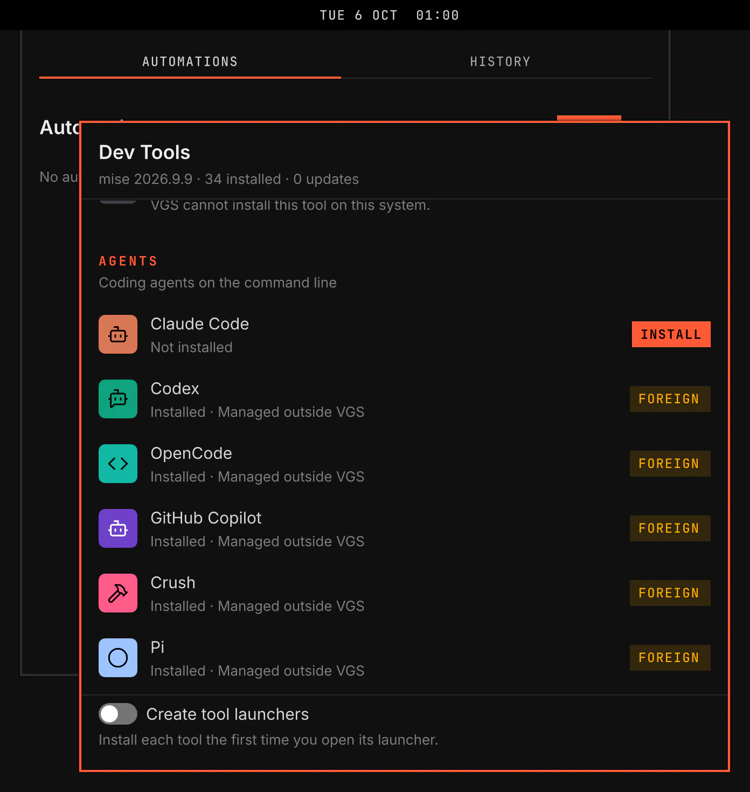

# Dev Tools

Dev Tools installs, updates, pins and removes developer tools: coding agents, apps, command-line tools, languages, editors, databases and terminals. Its Catalog page also shows the VGS version and the tools VGS is missing.



## Features

- A catalog with search and Installed, Updates and Not installed filters.
- Install, update, remove, pin and roll back a tool. Each change runs in a floating terminal.
- Update all updates every tool you have not pinned.
- A Dev Tools category in the launcher that installs a missing tool before it starts it.

## Setup

Dev Tools manages tools with mise. While mise is missing, select Review all missing or outdated tools on the Tools step of the Setup tab.

<details><summary>Show command</summary>

```bash
vgshell pkg run install mise
```

</details>

| Setting | What it changes |
| --- | --- |
| Show full catalog in launcher | Shows the catalog's tools in launcher search. |
| Add tool commands to the terminal | Lets a terminal start a catalog tool by name, and installs the tool the first time you run it. |

[developer.md](developer.md) states the catalog, the engine, the window and the launchers.
