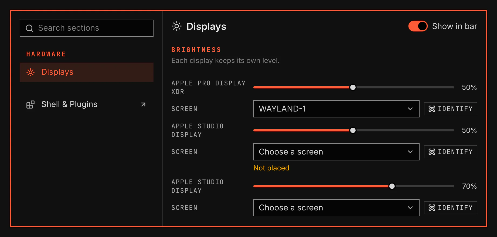

# Displays

Displays sets each screen's mode, scale, orientation and brightness. Apple Pro Display XDR and Apple Studio Display brightness works over USB, other external displays over DDC, and a laptop's built-in display over its backlight.



## Features

- A brightness item in each bar. Scroll over it to change the brightness, or click it for a slider per display.
- The brightness keys change the display you work on, or every display, and show the new level on screen.
- System Settings → Displays: arrange your displays and set each one's resolution, refresh rate, scale, orientation, colour and HDR.
- A mode change runs as a trial. Keep saves it; otherwise the old mode comes back.
- Choose the primary display for the login form. Saved layouts reach the login screen automatically once it is set up.
- Identify shows each screen's name, so you can tell two displays of one model apart.
- The displays dim after a time without input. A playing video keeps them bright.

## Setup

Brightness control for Apple displays and other external displays can need a one-time permission. When it does, Allow under Access on the plugin's Setup tab opens a terminal that shows the setup and asks for your password.

<details><summary>Show command</summary>

```bash
vgshell system apply apple-displays
vgshell system apply i2c-dev
```

</details>

| Setting | What it changes |
| --- | --- |
| Key and scroll step | How much one brightness key press or bar scroll changes the level. |
| Brightness keys change | The display the brightness keys change: the one you work on, or all. |
| Link displays | Change every display by the same amount. |
| Dim when inactive | Time without input before the displays dim, or Never. |
| Dimmed brightness | The level the displays dim to. A display already darker keeps its level. |

The keys are `XF86MonBrightnessUp` and `XF86MonBrightnessDown`. The Keys row on the plugin's Settings page changes them.
