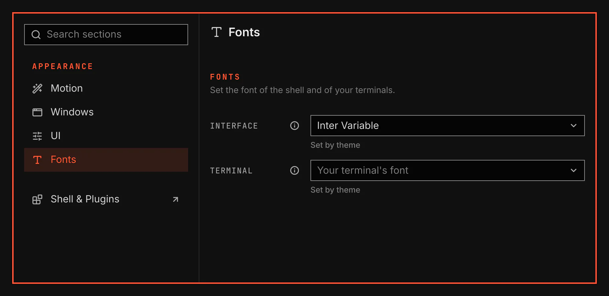

# Fonts

Fonts sets the font of the shell and the font of your terminals. It is for anyone who wants another typeface than the theme gives.

## Features

- A Fonts section under Appearance in the System Settings window.
- Each value shows Set by theme until you change it. Use theme value puts the theme's value back.
- The Terminal list holds only fixed-width fonts.
- The values stay in effect when you disable this plugin.

## Setup

| Value | What it changes |
| --- | --- |
| Interface | The font of the shell's text. Code, key names, the launcher and notifications keep their own fonts. |
| Terminal | The font of Kitty and Ghostty. Without a font here, each terminal keeps the font from its own config. |

VGS writes the terminal font into the theme files each terminal reads as soon as you choose it. Kitty changes at once. In Ghostty, open a new window if the font does not change. A font your own Kitty config sets after the VGS line stays in effect.
