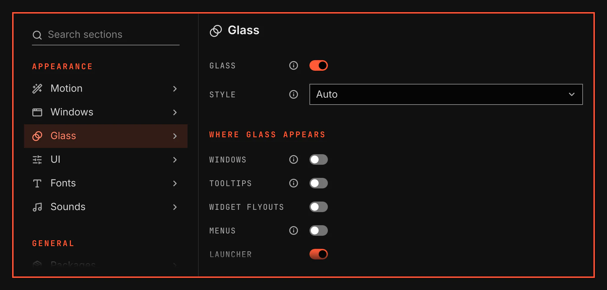

# Glass

Glass lets you choose where glass appears and how it looks: on the launcher, notifications, Jarvis's cards, windows, menus, flyouts and more.

## Features

- A Glass section under Appearance in the System Settings window.
- One switch turns glass on or off everywhere and keeps your other choices.
- Choose Auto, Light, Dark or Clear for the launcher, notifications and Jarvis. Auto follows your theme.
- Clear shows the background through the glass with white text, and Hyprland shades the glass over a bright background so the text stays readable.
- A switch for each surface: windows, tooltips, widget flyouts, menus, the launcher, notifications, Jarvis, dialogs, on-screen indicators and the clipboard. Buttons, switches and fields take the look of the card they are on.
- Optional layer glass bends the background at the edges of glass notification toasts and Jarvis cards in every style. The launcher and notification inbox get edge bend only in Clear.

## Setup

Open System Settings and choose Glass under Appearance.

Clear needs layer glass. Until layer glass is on, Clear surfaces draw on a solid ground and the page says why.

Layer glass starts off. Turning it on opens the installation screen when hyprglass is needed. Check again reads its current state. Turning it off unloads the whole hyprglass plugin and removes VGS's hyprglass settings, while keeping its packages and your configuration. A failed or canceled request stays visible. Rebuild asks first and refuses a rebuild that would change unrelated plugins. With the Glass switch off, hyprglass stays loaded and draws on no VGS surface.

VGS disables hyprglass window glass globally. A foreign `hyprglass_enabled` tag is your choice: VGS never writes or clears one, so a tagged window can still have glass.

An update moves your earlier glass choices here. If glass was on for every surface, the page offers Restore saved surface choices for the choices that setting overrode.
