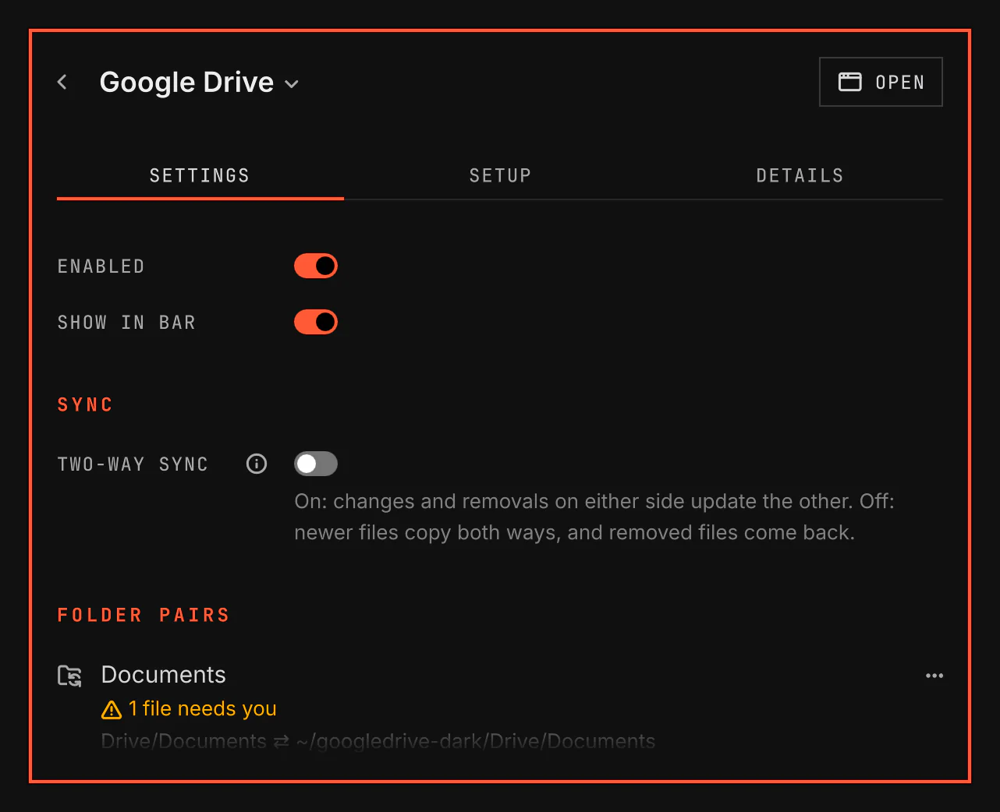

# Google Drive

VGS syncs folders on this computer with Google Drive. Choose copy-only sync or two-way sync that follows moves, renames and removals on either side. It runs every hour while you are logged in, also while VGS is closed.

## Features

- Folder pairs: each pair joins one Google Drive folder and one folder on this computer.
- Sync every hour while you are logged in, and at once with Sync now.
- Set Two-way sync in Settings. VGS keeps saved choices. A one-time update check keeps existing pairs on copy-only sync when no choice was saved; fresh installs start with two-way selected.
- With two-way on, a local removal sends the Drive copy to Trash. A Drive-side removal keeps the local bytes in the recovery folder for 30 days.
- With two-way on, ordinary-file moves and renames reach the other side. Between pairs, VGS copies the file to its destination and removes the old copy after both pairs run; this is not one physical rename.
- Google Docs, Sheets, Slides and Drawings stay on Drive. With two-way on, download-only Word, Excel, PowerPoint and SVG copies use a separate folder, offered from the flyout. Edit and rename native documents on Drive.
- When both sides changed, the newer file wins. VGS keeps a losing local version in recovery for 30 days; a resolved losing Drive version goes to Trash. If neither version is newer, both changed files stay for you to choose. A removal made while the other side edits a file can preserve the edit.
- Google controls Trash and revision retention. Emptying Trash can remove its recovery. For ordinary overwrites, Google may remove a revision after 30 days or 100 newer versions. To retain it, select Keep forever in [Manage versions](https://support.google.com/drive/answer/2409045).
- Turning two-way sync off selects copy-only runs: newer files copy both ways, and removed files come back at the next sync. Changing the switch itself changes no files and keeps pauses.
- Editor temporary files, unfinished downloads, Git folders, keys and credential files are never copied.
- A bar icon and its flyout show the sync state and the files that need you, with the fix one click away where VGS can run it.
- A notification when Google Drive needs you: a sign-in, a failed sync or a file that needs you.
- Pause stays on after a restart.

## Setup

Open the Google Drive page in Settings and select Setup. Take the steps in their order on the tab.

1. At the top, Open the step-by-step guide opens [Get your Google Drive keys](#get-your-google-drive-keys). Follow it to make your Client ID and Client secret in Google Cloud.
2. Under Google Cloud keys, select Add key beside Client ID and beside Client secret, and paste each key into its masked field. The Client ID ends in `.apps.googleusercontent.com`. The Client secret starts with `GOCSPX-`. VGS stores every key in your keyring.
3. Under Sign in to Google, select Sign in. Google opens in your browser. Step 6 of the guide says what to select on each Google screen.
4. Under First folder pair, select Add a folder pair and choose a name, the Google Drive folder and the folder on this computer. A folder pair cannot be your home folder, a folder that holds a Git repository, a folder of VGS or your system services, or the whole Drive, and two pairs cannot overlap. The hourly schedule turns on with the first folder pair.
5. If Two-way sync is on, a pair that needs setup stays stopped. The notice names the affected folders. Select Set up two-way sync from the notice or flyout to open that pair's setup, or choose a pair when several need it. The same action on the Setup tab always asks you to choose a pair. Keep other writers paused. Review earlier removals and moves, make the ordinary files match in both folders, then review the roots and preview. Confirm only when the preview shows the changes you want; No is selected first. Setup keeps the pair's pause. A failed or canceled setup must be reviewed and confirmed again.
6. Under Tools, select Review all missing or outdated tools when a tool is missing.

The setup preview lists missing access files to create in both folders and unchanged Google document download copies to move into the separate download folder. VGS keeps their subfolders. It moves only copies that match their saved sync record, and never replaces an existing download or discards a file. Edited or unknown copies and duplicate names on Drive stop setup with paths and instructions. Declining the preview creates no access files and moves no copies.

After an actual copy-only run, or a change to the account, folders or sync rules, two-way sync waits for this review and setup again. An unused off/on toggle can reuse a completed setup. A run that would remove more than half of either folder stops for an owner-reviewed preview and one-run allowance; VGS never raises that limit automatically.

Google document copies in the separate download folder can keep old names after a Drive-side rename or removal. Copy-only sync downloads these copies into the synced folder; the setup preview handles them before two-way sync starts.

The Settings tab lists your folder pairs. Remove, in a pair's More actions menu, stops its sync after you confirm. Sign out, on the Setup tab, stops the sync and removes the sign-in from your keyring. Either way, your files stay on this computer and in Google Drive. Disabling the plugin does not stop the hourly sync.

## Get your Google Drive keys

Google Drive needs a Client ID and a Client secret from your own Google account. Use the Google account whose Drive you sync in every step.

1. **[Make a project](https://console.cloud.google.com/projectcreate).** Name it VGS and select Create.
2. **[Turn on the Google Drive API](https://console.cloud.google.com/flows/enableapi?apiid=drive.googleapis.com).** Choose the VGS project if Google asks for one, then select Enable.
3. **[Describe your app to Google](https://console.cloud.google.com/auth/overview).** Google Auth Platform opens. Select Get started. Name the app VGS and give your email. For Audience, choose Internal if your account belongs to a Google Workspace organization, else External. Accept the Google API Services User Data Policy and select Create.
4. **[Publish the app](https://console.cloud.google.com/auth/audience).** Do this step only for External. On Audience, select Publish app. A new app starts in Testing. Google ends each sign-in to an app in Testing 7 days after you allow access, and Google Drive then stops until you sign in again ([Google](https://support.google.com/cloud/answer/15549945)).
5. **[Make the client](https://console.cloud.google.com/auth/clients).** On Clients, select Create client. For Application type, choose Desktop app, then select Create. Copy the Client ID and the Client secret now. Google shows the secret only when it makes the client ([Google](https://developers.googleblog.com/en/usability-and-safety-updates-to-google-auth-platform/)).
6. **Paste and sign in.** Add each key on the Setup tab, then select Sign in. On "Google hasn't verified this app", select Advanced, then Go to VGS. It is your own app. Tick the box for Google Drive access and select Continue.

If you lost the Client secret, open your client on [Clients](https://console.cloud.google.com/auth/clients) and select Add secret ([Google](https://support.google.com/cloud/answer/15549257)). Copy the new secret and add it on the Setup tab.

[developer.md](developer.md) states the sync contract, the conflict records, the credential rules, the files and the runner's commands.
