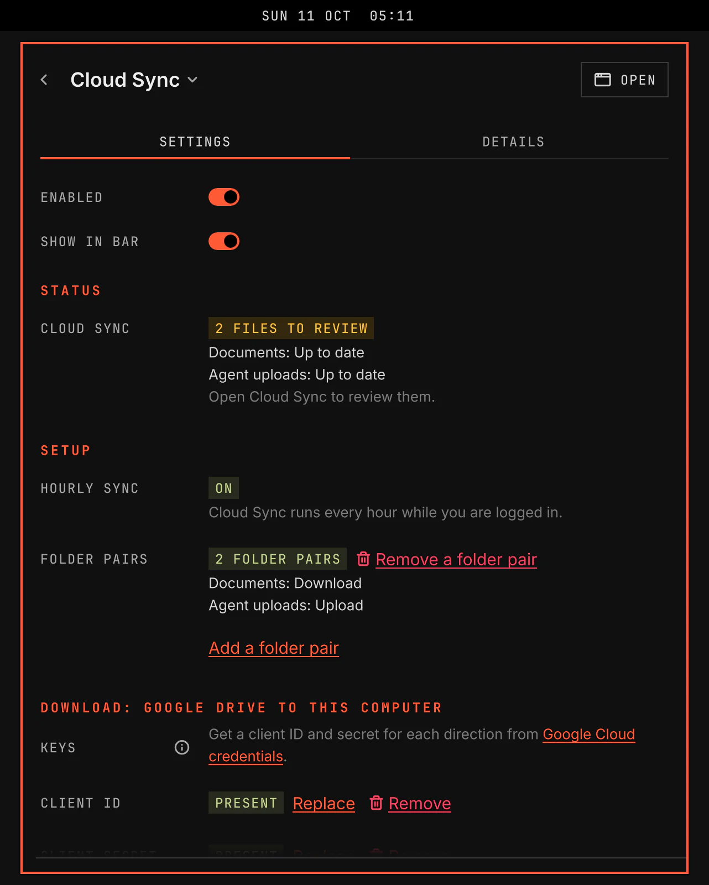

# Google Drive

VGS keeps Google Drive folders on this computer and in Google Drive. It runs every hour while you are logged in, also while VGS is closed, and never deletes a file.

## Features

- Folder pairs: each pair joins one Google Drive folder and one folder on this computer. VGS copies both ways. The newer file wins.
- Every hour while you are logged in, and when you select Sync now. An hour missed while you were logged out syncs once at the next login. One sync of a pair runs at a time, whoever starts it.
- Google Docs, Sheets, Slides and Drawings arrive as Word, Excel, PowerPoint and SVG files. A local file at the same name is never uploaded.
- Nothing is deleted. A file removed on one side comes back from the other side.
- When both sides changed, VGS keeps the older local copy in its records for 30 days when Google Drive was newer. When this computer was newer, Google Drive keeps the older Drive copy in the file version history for 30 days.
- Editor temporary files, unfinished downloads, Git and agent folders, `local/`, keys and credential files and old backups are never copied.
- Once a folder pair exists, a bar icon shows the state: up to date, files to review, syncing, paused, offline, Connect needed or failed, with the count of files to review. The bar, the window and the Settings page show the same state. The tooltip names each folder pair and its state. It never shows a file name or an account.
- A window with the state, the last complete sync, the last problem, the folder pairs with Remove, and the files to review, with Sync now, Pause and Resume.
- A notification when Google Drive needs you: Connect, a failed sync or files to review.
- Pause stays on after VGS or the computer restarts. Disabling the plugin does not stop the hourly sync.
- When Google Drive cannot be reached, the files stay as the last complete sync left them, and the window shows the time of that sync.

## Setup

Open the Google Drive page in Settings and select Setup. Setup holds the Google Drive connection and the first folder pair. Hourly sync and the later folder pairs are on the Details tab.

1. On the Details tab, under Hourly sync, select Set up hourly sync. A setup window starts the hourly sync. Google Drive syncs every hour while you are logged in.
2. Get the Google Drive keys from [Google Cloud credentials](https://console.cloud.google.com/apis/credentials). Create one OAuth client ID of type Desktop app.
3. Under Google Drive connection, select Add key beside Client ID and Client secret, and paste each into the masked field. VGS stores every key in your keyring.
4. Under Google Drive connection, select Connect. Google opens in your browser. Sign in and allow access. VGS stores the connection in your keyring, and the Google Drive line on the Details tab shows the Google account.
5. Under First folder pair, select Add a folder pair. A setup window asks for a name, the Google Drive folder and the folder on this computer. A folder pair cannot be your home folder, a folder that holds a Git repository, a folder of VGS or your system services, or the whole Drive, and two pairs cannot overlap.

Remove a folder pair, on the Details tab or beside the pair in the Google Drive window, stops the sync of a pair. Its files stay on this computer and on Drive.

If the folder pair list cannot be read, select Start the folder pair list again. VGS keeps the damaged list beside a new empty list.

When the Google Drive line reads Connect refused, select Connect again. Sign out removes the connection from your keyring and deletes no file.

[developer.md](developer.md) states the sync contract, the conflict records, the credential rules, the files and the runner's commands.
