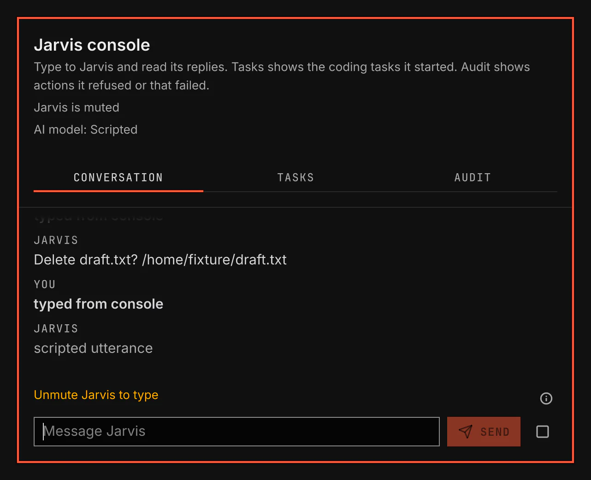
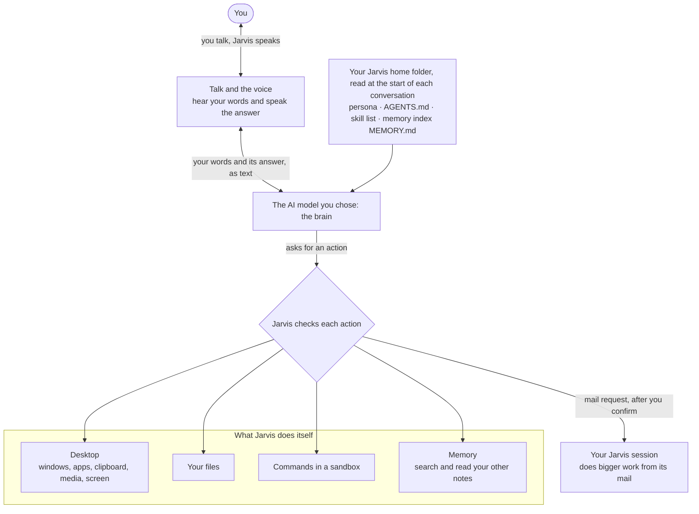

# Jarvis

Jarvis is a voice assistant for your desktop. You talk to it, and it answers with the AI model you choose. It can work with your windows, files, clipboard, media and screen, and with a private browser. It asks you before it does something you cannot undo. [How it works](#how-it-works) shows it in one picture.

## Features

- Talk with a key, or say Hey Jarvis.
- Local voice, the default: Jarvis hears you and speaks on your computer.
- Cloned voice, off at first: the local voice speaks in a voice recorded on your computer, on an NVIDIA graphics card.
- Realtime voice from OpenAI with a saved OpenAI key, a slower cloud option.
- Gemini Live voice from Google with a saved Gemini key, a second cloud option.
- ElevenLabs voice with a saved ElevenLabs key: the local voice hears you, and Jarvis speaks the reply in a voice of your ElevenLabs account, a voice you designed or cloned on ElevenLabs's site among them.
- The AI model you choose: an app you are signed in to (Claude Code, Codex, GitHub Copilot, or Pi with its own providers) or an API key.
- Backup models that Jarvis tries when the answering model fails.
- Short commands, such as "turn the volume up" or "go to workspace three", act at once with no AI model call.
- Control of windows, workspaces and applications.
- File tools for your home folder.
- Commands that run inside a sandbox.
- Clipboard, media, volume and notification tools.
- Screen reading, with private windows painted black.
- A private browser that asks before it submits.
- Coding tasks in tmux or a floating terminal, with spoken questions and answers.
- A bar icon that shows what Jarvis is doing.
- A Console window with Conversation, Tasks and Audit tabs.
- A mute that stays on across restarts.
- A home folder with your instructions, skills and memory, which every AI model uses.
- Start Jarvis at boot: your Jarvis session starts in the home folder when VGS starts after you sign in.
- Requests to your agent fleet, sent after you confirm them.
- Provider keys kept in your desktop keyring.

## How it works

At the start of each conversation, Jarvis gives the AI model four texts from your home folder: the persona, which says who Jarvis is; your instructions in `AGENTS.md`; the list of your skills, with each skill's name and first line; and `MEMORY.md`, the index of your memory notes. The AI model reads a whole skill only when it needs it. It searches your other memory notes and reads the ones it needs. The voice gets none of this text.

Jarvis does a request itself when its [tools](#tools) can do it: the desktop, your files, commands in a sandbox, your memory notes, the private browser and coding tasks. A short command, such as "turn the volume up", goes to the check with no AI model call.

A request for your agent fleet goes to your Jarvis session: your chosen app, running in your home folder. Jarvis shows you the request and puts it in the session's mailbox only after you confirm, at most one each time you ask. The session does the work when it next reads its mail. [Agent fleet requests](#agent-fleet-requests) says more.

1. You press Talk, or say Hey Jarvis in Always talk mode.
2. The voice turns your words into text. The local voice does this on your computer. The Realtime voice sends your voice to OpenAI, and the Gemini Live voice sends it to Google.
3. Jarvis sends the text to the AI model you chose, with your instructions from the home folder.
4. The AI model answers. When it asks for an action, such as moving a window or reading a file, Jarvis checks the action first. Jarvis asks you before it deletes a file, runs a command or sends something. It calls an action done only after it sees the result.
5. Jarvis speaks the answer. With the ElevenLabs voice, ElevenLabs turns the answer into speech.

What leaves your computer: the text of your request goes to the AI model you chose, over the network when that model runs outside your computer. With the Realtime voice, your voice goes to OpenAI; with the Gemini Live voice, it goes to Google. With the ElevenLabs voice, your voice stays on your computer, and the answer Jarvis lets out goes to ElevenLabs. ElevenLabs keeps request history, and may use it to improve its models unless you turn that off in your ElevenLabs account under Terms and privacy, Data use. A screenshot goes out only as Screen to cloud allows. Jarvis keeps your keys in your desktop keyring.

## Turn Jarvis on

Jarvis is on when you install VGS. The Enabled switch on the Jarvis page, in Settings → Plugins → Jarvis, turns it on or off. Turning it off stops your Jarvis session and prevents automatic starts.

To talk to Jarvis, do the steps that the Setup tab of the Jarvis page shows:

1. Under AI model, choose an Account. Sign in opens an app's own sign-in. Add key stores an API key.
2. Press Set up local voice. It downloads the voice that runs best on your computer.
3. Press Talk: Super with Right Alt.

Setup says Ready when Jarvis has an AI model and the selected voice.

## Bar icon

The tooltip says what to do next. When an AI model is active, the tooltip names it. A click turns mute on or off.

| State | Icon | When | What the tooltip tells you |
| --- | --- | --- | --- |
| Off | A power symbol | Jarvis needs setup, a requirement, or an unlocked screen. | The setting or action that turns Jarvis on. |
| Loading | A spinner | Jarvis starts, checks its setup or loads the local voice. | What is loading, and to wait. |
| Ready | A microphone | Jarvis can listen. | How to talk: hold Talk, press Talk, or say Hey Jarvis. |
| Listening | Sound bars | The microphone is open. | Speak now, or say Hey Jarvis in Always mode. |
| Working | A thinking icon | Jarvis is thinking, waits for your confirmation or uses a tool. | What Jarvis is doing, and the Stop or Confirm key. |
| Speaking | A speaker | Jarvis speaks its answer. | That Jarvis is speaking, and the Stop key. |
| Muted | A crossed-out microphone | Mute is on. | Click, or press the Mute key, to turn mute off. |
| Problem | An alert circle | Jarvis or its audio stopped with a fault. | What failed and what to do, from the first failed start. |

## Keys and voice

| Key | Default | What it does |
| --- | --- | --- |
| Talk | Super with Right Alt | Opens the microphone. Talk mode decides whether you hold it or press it. Press it while Jarvis speaks to interrupt. |
| Mute | Super with Shift and Right Alt | Turns the Jarvis microphone off or on. Mute stays on across restarts and blocks Talk. |
| Stop | Super with Alt and Period | Stops what Jarvis does now: listening, thinking or speaking. |
| Confirm | Super with Alt and Y | Confirms the Jarvis request on the screen. |
| Console | Super with Alt and C | Opens the Console window. |

You can change the keys under Keys on the Jarvis page.

- In the Console, Conversation lets you type to Jarvis and read its replies. Tasks shows coding tasks, and opens or stops the selected task. Audit shows recent actions that Jarvis refused or that failed.
- The listening bubble lets clicks go through to the application below it. While Jarvis waits for Hey Jarvis, the bubble shows a still orb.
- In Always talk mode, the local voice on your computer listens for Hey Jarvis. Nothing goes to the AI model until you speak after it.
- Jarvis closes its microphone while it speaks. Talk interrupts it.
- The local voice works with no network after Set up local voice. voxtype, the dictation program that Voice also uses, records your words from the system default microphone. Its tones tell you when it records. You set them in Appearance → Sounds.
- With a cloud voice, OpenAI for Realtime or Google for Gemini Live hears you and speaks the reply. The AI model you chose still answers each request, and Jarvis still checks each action and what it sends.
- With the ElevenLabs voice, the local voice hears you, Hey Jarvis included, and ElevenLabs speaks the reply. Always talk mode works with it. Talk interrupts it, as it interrupts the local voice.

## Setup

The Setup tab of the Jarvis page lists the required Home folder, AI model, Voice and Tools steps. Each reads Done or To do and keeps its row after completion. A pending step explains what to change and offers its action as a text link. Settings holds the choices, such as Account and the local voice model. Details holds the readings, each in the section of its feature: AI model for provider keys, accounts and Copilot Memory; Voice; Local voice for the local voice and Cloned voice; Home for Personality, the Jarvis session and Memory search; and Access for Browser, Desktop input and Agent fleet. Each optional action sits beside its reading, and the optional tools are under Tools. The Local voice reading offers no action: Set up local voice is on the Voice step, and choosing another Local voice model downloads that model.

The buttons are also rows in the launcher's Jarvis group. Each opens a floating terminal.

- Add key stores an API key from an AI provider, or an ElevenLabs key, in your desktop keyring. You type the key in a hidden field. Choose the provider from a list that names the page where it makes keys, then give the key a name. The Jarvis page shows whether a key is present, absent, locked or unavailable, and never shows the key.
- Remove key deletes an API key you stored with Add key from your desktop keyring. Choose the key from the list, then confirm once. If the key was the Voice key, Jarvis clears that choice. A conversation that is open uses the key until it ends. A key that another app saved stays in your keyring; Jarvis only stops using it.
- Sign in opens the app's own sign-in: Claude Code, Codex, GitHub Copilot or Pi. Give a new account a name, or select an existing account folder. Jarvis shows the folder before sign-in and makes it if needed. After sign-in, select the account under AI model. The app keeps its own login.
- Set up local voice downloads the local voice model that runs best on your computer. It checks free space, downloads the models and a private runtime, and says Ready only after it checks the download and a test clip passes. To use another model, choose it under Local voice model.
- Set up cloned voice, beside Cloned voice on the Details tab and not in the launcher, shows Resemble AI's use text and asks two questions: whether you read it, and whether the voice is yours or you have the speaker's permission. Any answer but two yeses downloads and stores nothing. It then downloads the model and a private runtime, records 10 seconds while you read a sentence aloud, and says Ready after a test sentence in that voice is made on your computer, with nothing played. It needs the Large local voice model ready. Remove recording deletes the recording and turns off Cloned voice when its terminal closes; the model stays for a later setup.
- Set up dictation makes voxtype ready for the local voice and downloads its speech model. Review all missing or outdated tools under Tools on the Details tab opens the notice to install voxtype while it is missing.
- Set up browser checks a browser that is installed, on a blank page, or offers a private download. Review all missing or outdated tools under Tools on the Details tab opens the notice to install agent-browser while it is missing.
- Accounts adds an account folder, chooses a keyring item by its label, or shows login hints. It finds the account folders of your other tools in your home, config and data folders. It can use a key that another tool stored, without a copy of the key. A login hint does not prove that the AI answers.
- Verify sends one small request to an account, after you agree, because a real request can cost money.
- Check input checks the desktop input tools.

When a tool that Jarvis needs is missing, the VGS requirement notice installs it with one click.

Home folder shows in Setup only when Jarvis cannot use the folder you chose, and says what to change. Jarvis checks the folder again when you press Talk.

With the ElevenLabs voice, the Details tab shows ElevenLabs voices. Until you choose a stored key it reads No key chosen or Key not stored; then it says how many voices Jarvis read, that it is reading them, or that it could not read them. While no stored key is chosen, and when Jarvis could not read the voices, it links ElevenLabs API keys, where you make a key and see what the key may read. You design or clone a voice on ElevenLabs's site, under Voices; Voice then lists it.

With a GitHub Copilot account, the Details tab shows Copilot Memory. GitHub keeps that memory in your account, so only you can turn it off: open [GitHub Copilot settings](https://github.com/settings/copilot/features) and set Copilot Memory to Disabled.

## Settings

The settings are in Settings → Plugins → Jarvis. A change to Voice provider, Voice, Account, Model, Backup models, Effort, Home folder or Screen to cloud ends the current conversation.

| Setting | What it changes |
| --- | --- |
| Talk mode | Hold: Jarvis takes what you said when you release Talk. Toggle: the conversation stays open until you press Talk again. Always: say Hey Jarvis, then your request; Talk listens at once. Always needs the local voice, alone or under ElevenLabs, because your computer listens for the words. The bubble stays on the screen while the microphone is open. |
| Microphone | The microphone a cloud voice uses. The local voice uses the system default microphone. |
| Speaker | The speaker Jarvis uses. |
| Voice provider | Local is the default: speech stays on your computer, and Jarvis answers fastest. Realtime sends your voice and the results Jarvis lets out to OpenAI, and Gemini Live sends them to Google; both answer more slowly. ElevenLabs speaks the replies in your ElevenLabs voices, and Local still hears you. Auto uses Realtime when an OpenAI key is stored, and Local when none is; it never uses ElevenLabs. In Always talk mode, Auto uses Local. Local, Realtime, Gemini Live and ElevenLabs stay as you set them, whatever keys are stored. |
| Voice key | The key the cloud voice uses: an OpenAI key for Realtime, a Gemini key for Gemini Live, an ElevenLabs key for ElevenLabs. Add key stores a key in your desktop keyring. Get an OpenAI key at [OpenAI API keys](https://platform.openai.com/api-keys), a Gemini key at [Google AI Studio](https://aistudio.google.com/apikey), or an ElevenLabs key at [ElevenLabs API keys](https://elevenlabs.io/app/settings/api-keys). With one key of the chosen voice, Jarvis selects it. With more keys, choose one. |
| Voice | How Jarvis sounds, from the voices of the selected voice provider. With ElevenLabs, the voices of your account: its premade voices and the voices you designed or cloned on ElevenLabs's site, at most 64, yours first. Jarvis reads them again each time you open this page, and, after a read that failed, when you press Talk. Preview, under Voice on the Details tab, says one sentence in that voice; with a cloud voice it asks first, because it uses your key. |
| Local voice model | Auto is the model that runs best on your computer, from its graphics card memory, its memory and its processor. The list shows each other model your computer can run, with its download size. When you choose one, it downloads in a floating terminal, which asks first if it replaces a model that is ready. The choice changes the voice Jarvis speaks with. Dictation uses voxtype's model: change it with Choose model in Voice. |
| Cloned voice | Off at first. On, Jarvis speaks in the voice that Set up cloned voice, on the Details tab, recorded, with Chatterbox Turbo by Resemble AI under the MIT licence. The recording and the model stay on your computer. It needs the Large local voice model on an NVIDIA graphics card; until its setup says Ready, Jarvis speaks in the local voice model's voice. Changing it ends the conversation. |
| Account | Under AI model: the AI that answers you. It is an API key you added, or an app you are signed in to. The list shows only the choices Jarvis can use. An app with more than one account shows each account by its sign-in email. |
| Model | The model the chosen app or API key runs, from its own list. Jarvis reads the list while the page is open. Jarvis selects Fable 5.1 where the app offers it, else Opus 5.5, else the app's own model. Pi names each model with its provider, and Jarvis selects Pi's own model. Before the page reads a list, Claude Code runs Fable 5.1 at high effort, an Anthropic API key runs Opus 5.5 at high effort, and any other app runs its own model. A model you saved that leaves the list stays saved and shows as unavailable. The field shows for Claude Code, Codex, GitHub Copilot, Pi and an Anthropic API key. Each read of GitHub Copilot's list adds one empty session to your Copilot history, one each time you open this page. When the app does not give its list, the field shows the model Jarvis runs, with "list not read". When the app cannot use the model, Jarvis says so with the model's name and tries the next backup model. |
| Backup models | The models Jarvis tries, in order, when the answering app refuses a request, needs a sign-in, reaches a usage limit or stops during an outage. Jarvis tells you that the new model did not hear the earlier conversation. It sends the request again only when no tool ran and no reply was spoken. Otherwise it asks you to say the request again. |
| Effort | How much the model thinks before it answers. More effort takes longer. Jarvis selects High for Fable 5.1 and Opus 5.5, and the model's own level for other models. For Pi, Jarvis selects the model's own level. The field shows only for a model that takes an effort level. GitHub Copilot sets its own effort, so it shows none. |
| Home folder | The folder for what Jarvis knows. The list holds the folders Jarvis used before. None gives Jarvis only what VGS supplies. |
| Start Jarvis at boot | Off at first. "When VGS starts after you sign in, a tmux session starts Jarvis in your selected home folder." The Jarvis session is your chosen app, running in the home folder in a terminal. Voice and chat work without it. It is the session that does your agent fleet requests. Read [Jarvis session](#jarvis-session). |
| Session at boot | Shows while Start Jarvis at boot is on. Resume the last session resumes your saved Jarvis conversation and checks its unfinished work. If that conversation is not available, a new session continues the saved work. Start a new session starts a fresh conversation and continues the work saved in your Jarvis home. It does not erase your work. The choice applies at the next boot. A session that already runs is not replaced. |
| Task terminal | Where a coding task opens. Auto uses tmux when it is installed, so several tasks run at the same time, and the floating terminal when it is not. The floating terminal shows one task at a time. |
| Screen to cloud | Whether a screenshot, or its text, goes to an AI or a voice outside your computer. Ask withholds it unless you allow it for the conversation. Allow sends it. Never withholds it. When the AI model and the voice both run on your computer, they always get it. |
| Private windows | Words, with commas between them. Jarvis paints a window black before a screenshot leaves Jarvis when its class or title contains one of the words. A title cannot always show private browsing. |

Personality, under Home on Details, shows how Jarvis talks: the text under the heading `## Personality` in `AGENTS.md` of the home folder. Edit opens it. Every AI model reads it.

Mute closes only the microphone. Show in bar puts the bar icon back after Hide.

## Jarvis session

Start Jarvis at boot, under [Settings](#settings), states when the session starts and what it runs. The app is the Account you chose under AI model. A restart of VGS does not start a second session. [Turn Jarvis on](#turn-jarvis-on) states what the Enabled switch does to the session.

The Jarvis package in the home folder starts and owns the session. The Jarvis session row on the Details tab shows what the package reports: for example Running, Starting, Off or Cannot start, with a sentence that tells you what to do. Start shows while no session runs. Retry shows after a start failed. While tmux is missing, select Review all missing or outdated tools under Tools on the Details tab.

- No session can start with an API key or a local model as the Account. Under AI model, choose an app as the Account.
- When you change the home folder or the Account, Jarvis checks the new choice, then restarts the session.

Show command

VGS starts and stops the session with `.agents/skills/jarvis/scripts/jarvis-session` of the Jarvis package in the home folder, which kendex installs. The session is the tmux session `jarvis` on your own tmux server, and `tmux attach -t jarvis` opens it.

## Tools

- Window, workspace and application tools check each change in Hyprland before they report it done.
- File tools list, read, search, write, move and delete files in your home folder. They refuse password and key stores, account folders and VGS's own files. They never follow a link out of your home folder.
- Commands run inside a sandbox that the Linux kernel enforces. The Jarvis page shows whether the sandbox is ready, and Review all missing or outdated tools on the Tools step of Setup opens the notice to install Bubblewrap when it is missing.
- Desktop tools read and copy clipboard text, play, pause and skip media, set and mute the speaker volume, and show a notification. Jarvis does not read a clipboard copy that a password manager marks as secret.
- Screen tools read the screen, a monitor, a window, a region or an area you draw, at most four times for each request. Jarvis paints the windows of password managers and private browsing black before a screenshot leaves Jarvis.
- The private browser comes from Set up browser. Jarvis asks you before it clicks or types on each site, and before each submit. You type passwords yourself.
- Coding tasks run in their own tmux session or a floating terminal. The Jarvis page shows how many run. When you stop a task, Jarvis ends all of its processes before it shows the task as stopped.
- Jarvis speaks a coding agent's question and sends your spoken answer back to it. It calls a task done only when the agent reports it done. When no conversation is open, it shows the questions as desktop notifications.

## Home folder

Choose a folder under Settings → Plugins → Jarvis → Home folder. You can change to another home there, or open Jarvis homes in the launcher and select a folder. The current home has a folder icon with a check mark. Every AI model uses your instructions, skills, memory and work in it in the same way.

No AI model can change anything in the folder but its `state/` part, except through an agent fleet request. Jarvis adds the entries that the folder does not have, and changes no file it finds but the Jarvis package files that VGS wrote there. It also removes a `skills/base/` folder, which older VGS versions wrote, and a `CLAUDE.md` whose only line is `@AGENTS.md`, because Claude Code reads `AGENTS.md` itself. It never follows a link in the folder. It does not start with a folder that has a link in place of an entry below, or a link in place of a Jarvis package file that VGS writes or a folder above one.

| Entry | What it holds |
| --- | --- |
| `AGENTS.md` | Your instructions for Jarvis: who it is and how it talks. Every AI model gets this text at the start of a conversation. Its budget is 8 KB: Jarvis reads a longer file whole, and the Home folder step on Setup and the Personality row say that it is over its budget. Claude Code and Codex read it too, in your own session in this folder. |
| `.agents/skills/jarvis/` | The Jarvis skill: `SKILL.md`, `persona.md`, `README.md`, `references/` and `workflows/`. Every AI model gets `persona.md` before `AGENTS.md`, and reads the skill, each reference and each workflow when it needs them. Jarvis does not start with the folder while this skill has no `SKILL.md` or `persona.md`, is a link, or holds a link or an entry that is not a folder or a file. |
| `.agents/skills/`, `.claude/skills/`, `.claude/agents/`, `.codex/agents/` | The Jarvis package, at the same paths as kendex installs it: the Jarvis skill and each skill that it requires, for Claude Code under `.claude/skills/` and for other tools under `.agents/skills/`, and each agent that it names, for Claude Code and Codex. An agent is a set of instructions for one kind of work, such as tax work for `cpa` or legal work for `legal`. Your own session in the folder can give work to an agent by its name; the AI models that Jarvis starts use no agent. In a folder where kendex did not install the Jarvis skill, VGS writes the package files and lists them in `.vgs-package.json`. When a file in that list is different from the copy VGS installed, after an update or an edit, Jarvis replaces it, and it removes a file that the package no longer has. Keep your changes in `AGENTS.md` and `skills/own/`. Jarvis does not change your other files in these folders: a file of yours at the path of a package file stays as it is, and so does each file that kendex installed. In a folder where kendex installed the Jarvis skill, Jarvis changes no package file, and it does not start while that skill is not at `.agents/skills/jarvis/`. Install mail tool, on the Agent fleet row on the Details tab, takes VGS's package files out of the folder before kendex installs, and Jarvis writes again what kendex does not install. |
| `skills/own/` | Your own skills. A skill is a Markdown file, or a folder with a `SKILL.md` file. Its name is the file name without `.md`, or the folder name. A name starts with a letter or a digit, has only letters, digits, `_` and `-`, and has at most 48 characters. Jarvis skips a skill with another name. A folder skill's `references/` holds more Markdown files. Each is a skill named `<skill>/<file name without .md>`, by the same rule. Its `workflows/` holds its task steps, each a skill named `<skill>/workflows/<file name without .md>`, so a reference and a workflow can have the same file name. Every AI model gets each skill's name and first line, or its `description`, and reads the skill when it needs it. A skill has no size limit. |
| `memory/` | Your memory notes. `MEMORY.md` is their start file: write one line for each note, with the note's path in this folder. Every AI model gets `MEMORY.md` at the start of a conversation, searches notes when it needs memory, and reads notes by their paths. The budget of `MEMORY.md` is 4 KB: Jarvis reads a longer file whole, and the Home folder step on Setup says that it is over its budget. A note is a Markdown file whose name ends in `.md`. Jarvis reads no note whose name or folder name starts with a dot, and nothing in `inbox/`: keep a note there until you checked it. |
| `state/` | Work in progress. This is the one part of the folder that Jarvis's file tools can read or change. They refuse all other paths in the folder, your own files that this table does not name included. Jarvis tells every AI model where this folder is. |
| `.claude/settings.json`, `.codex/config.toml` | Settings that turn off the memory of Claude Code and Codex for your own session in this folder. |

A size budget applies only to the text every conversation starts with: `persona.md` at 3 KB, `AGENTS.md` at 8 KB, the list of skill names and first lines at 8 KB, `MEMORY.md` at 4 KB, and the whole start text, the Jarvis guidance included, at 32 KB. That text uses space in every conversation. Jarvis reads a text over its budget whole and keeps answering, and the Home folder step on Setup names it. When the start text is larger than an AI model can take, that request fails and Jarvis stays on: the AI model refuses it, or Jarvis does not send a request over 20 MB to an AI model it calls without an app such as Claude Code. A skill, a reference or a workflow uses space only in the conversation that reads it, so it has no budget.

A folder of skills has a limit: 256 entries in `skills/own/` or in one skill's `references/` or `workflows/`. Jarvis stops reading a folder at that limit, so that a very large folder cannot stop it. Jarvis does not start a conversation while a folder is over the limit, and the Home folder step on Setup says so.

The folder gives Jarvis knowledge, never permission. A skill that says an action needs no question changes nothing: Jarvis still asks before it deletes a file, runs a command or sends something.

The AI models never run inside this folder. A setting, hook or server that you keep there for your own tools does not run in Jarvis. Each app's own memory is off while Jarvis uses the app.

### Agent fleet requests

A request for your agent fleet goes to the mailbox of your Jarvis session, which does the work. Jarvis shows you the text and asks you to confirm it. Then it gives the request to the mailbox in the home folder with the kendex mail tool there, and tells you the request's number when the mailbox has it. Your Jarvis session does the request when it next reads its mail. Jarvis does not check that a session runs: Start Jarvis at boot starts yours at each boot. Jarvis sends at most one fleet request each time you ask it something.

The mail tool and the Jarvis package's session program are the only two programs in the home folder that VGS starts. Install mail tool, on the Agent fleet row on the Details tab, installs the mail tool. Jarvis offers fleet requests after your Jarvis session has read this folder's mail.

### Cloned voice

The recording is a 24 kHz WAV file only you can read, in Jarvis's private state folder, outside the plugin folder. The model runs in a process and a runtime of its own on the graphics card, beside the Large model, and reaches no network. Jarvis never sends the recording or its path to an AI model.

Show command details

Set up cloned voice runs `setup-local clone install`, then `pw-record --raw --rate 24000 --channels 1 --format s16 -` for 10 seconds into `setup-local clone record`. Remove recording runs `setup-local clone remove`. The recording is `~/.local/state/vgshell/jarvis/voice-reference.wav`.

### Memory add-ons

Jarvis searches the notes in `memory/`. It keeps its search index in its private files, and makes the index again when it is missing.

Other apps can show the same notes. Install them yourself, and give each one read-only access to `memory/`.

- Basic Memory can use the folder. Basic Memory is AGPL software. VGS never includes it.
- Obsidian can use the folder as a vault.
- QMD can use the folder for Markdown notes.

A note can have front matter fields that Jarvis reads: `title`, `aliases`, `date` as `YYYY-MM-DD`, and `sources`. A `sources` value such as `web` tells Jarvis where the note came from, so Jarvis asks you before it sends that note's text out. `[[note]]` links connect notes, and Jarvis shows the notes that link back to a note when it reads it.
