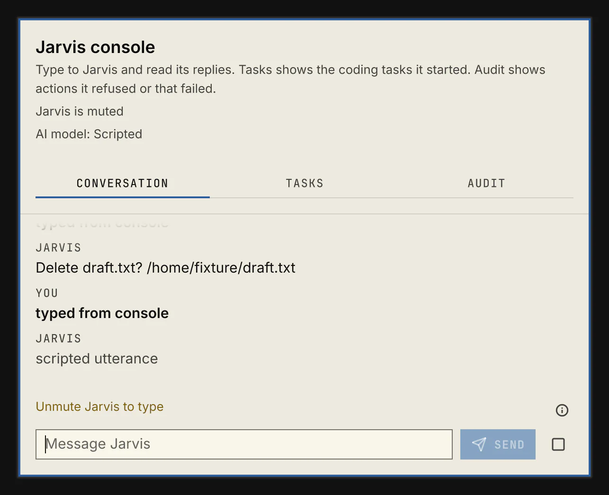
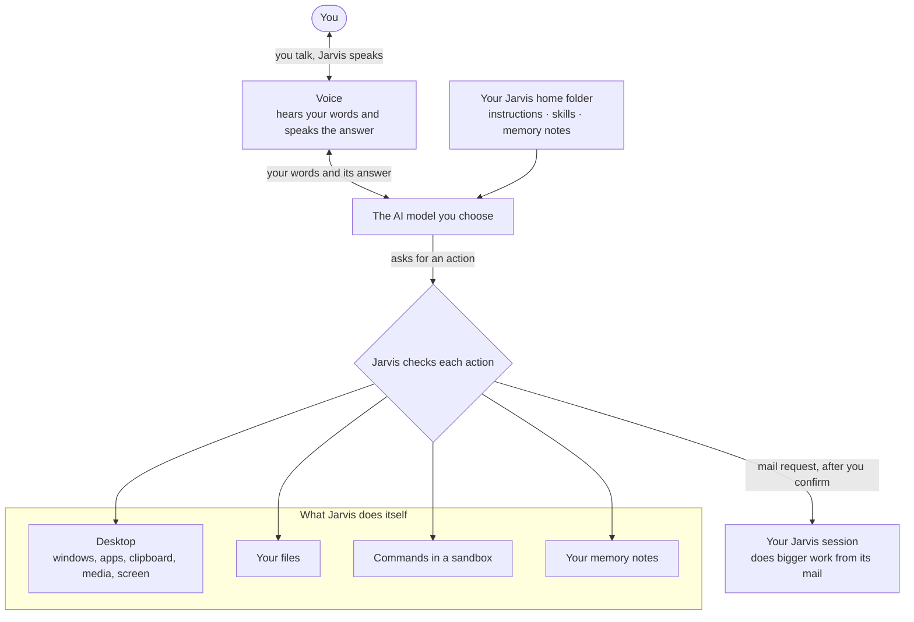

# Jarvis

Jarvis is a voice assistant for your desktop. Talk or type to the AI model you choose, ask it to work with your windows and files, or give it a coding task. It asks before it deletes a file, runs a command or sends something.

## Features

- Tap or hold a key to talk, or say Hey Jarvis.
- Hear and speak on your computer with Local voice.
- Choose OpenAI Realtime, Gemini Live or ElevenLabs for cloud voice.
- Speak in a voice recorded on your computer after cloned-voice setup.
- Use Claude Code, Codex, GitHub Copilot, Pi or an AI provider key, with backup models.
- Change volume or workspace with short spoken commands.
- Work with windows, applications, files, clipboard, media and notifications.
- Read your screen with private windows hidden, and run commands in a sandbox.
- Use a private browser that asks before it submits.
- Give coding agents work, hear their questions and answer by voice.
- Read conversations, coding tasks and refused actions in the Console.
- Share your instructions, skills and memory notes with every answering AI model.
- Start or resume your Jarvis session and send it confirmed agent fleet requests.
- Keep provider keys in your desktop keyring and mute Jarvis across restarts.

## How it works

Jarvis turns your words into text and asks your chosen AI model to answer. The model uses your instructions and reads skills or memory notes when it needs them. Jarvis checks an action before it runs and checks the result before it calls the action done. A request for your agent fleet goes to your Jarvis session after you confirm it; that session works through its mail.

Your request goes to the AI model you choose, over the network when that model runs elsewhere. Local voice keeps speech on your computer. OpenAI Realtime sends speech to OpenAI; Gemini Live sends it to Google. ElevenLabs hears you locally and sends replies to ElevenLabs to speak. ElevenLabs keeps request history and may use data to improve its models; change this under Terms and privacy → Data use in your [ElevenLabs account](https://elevenlabs.io/docs/help-center/legal/is-my-data-used-to-improve-eleven-labs-ai-models).

## Setup

Jarvis comes with VGS. Open Settings → Plugins → Jarvis → Setup and complete the steps it shows:

1. Choose an Account under AI model. Sign in uses the app's own sign-in; Add key stores a provider key.
2. Choose a Voice provider. For Local, press Set up local voice. For a cloud voice, use Add a key and choose the Voice key. Run Check microphone when Setup offers it.
3. When Setup says Ready, tap Talk, Super with Right Alt, and speak.

The Jarvis J in the bar shows what to do next. Click it to open the Console, or use its right-click menu to mute or unmute. A saved session's Resume offer takes that click until you resume or dismiss it. Change Talk, Mute, Stop, Confirm and Console shortcuts on the Keys tab. The Enabled switch turns Jarvis off and stops its session.

The Settings tab holds these choices. Each setting's information button explains it; the Details tab shows readings and faults.

| Setting | What to choose |
| --- | --- |
| Account and Model | The AI that answers you. Backup models are the alternatives to try when it cannot answer. |
| Voice provider and Voice | Local, or the cloud company and voice you want. Local voice model selects a download for your computer; leave it on Auto to let Jarvis choose. Realtime and Gemini Live take speech only. |
| Talk mode | Tap or hold, Toggle, or Always. Always listens locally for Hey Jarvis and works with Local or ElevenLabs. Press Talk to interrupt a spoken reply. |
| Microphone and Speaker | Your audio devices. Local voice uses the system default microphone; change it in System → Sound. Feedback tones live in Appearance → Sounds. |
| Home folder | Where Jarvis keeps your instructions, skills and notes. Edit your instructions with Personality on Setup; Home folder on Setup opens the folder. |
| Screen to cloud and Private windows | Ask, allow or block sending screen images or text outside your computer. Choose the window words Jarvis paints black first; titles do not reliably identify private browsing. |
| Start Jarvis at boot and Session at boot | Start your chosen app in your Home folder when you sign in, resuming its saved conversation or starting a new one. Voice and chat work without this session. |

Use Optional tools on Setup for missing tools. For agent fleet requests, use Install mail tool on the Agent fleet step and start your Jarvis session from its Setup row. With GitHub Copilot, turn Copilot Memory off in [GitHub Copilot settings](https://github.com/settings/copilot/features); Details links to that account setting too.

Cloned voice is optional and starts off. Set it up on the Cloned voice step with your own voice or the speaker's permission. It needs the Large local voice model and an NVIDIA graphics card; the recording and model stay on your computer. ElevenLabs voices you design or clone on its site appear under Voice after you select its key.

## Licence

[MIT](../../../LICENSE). The private-browser skill is [Apache-2.0](backend/skills/browser/LICENSE).
