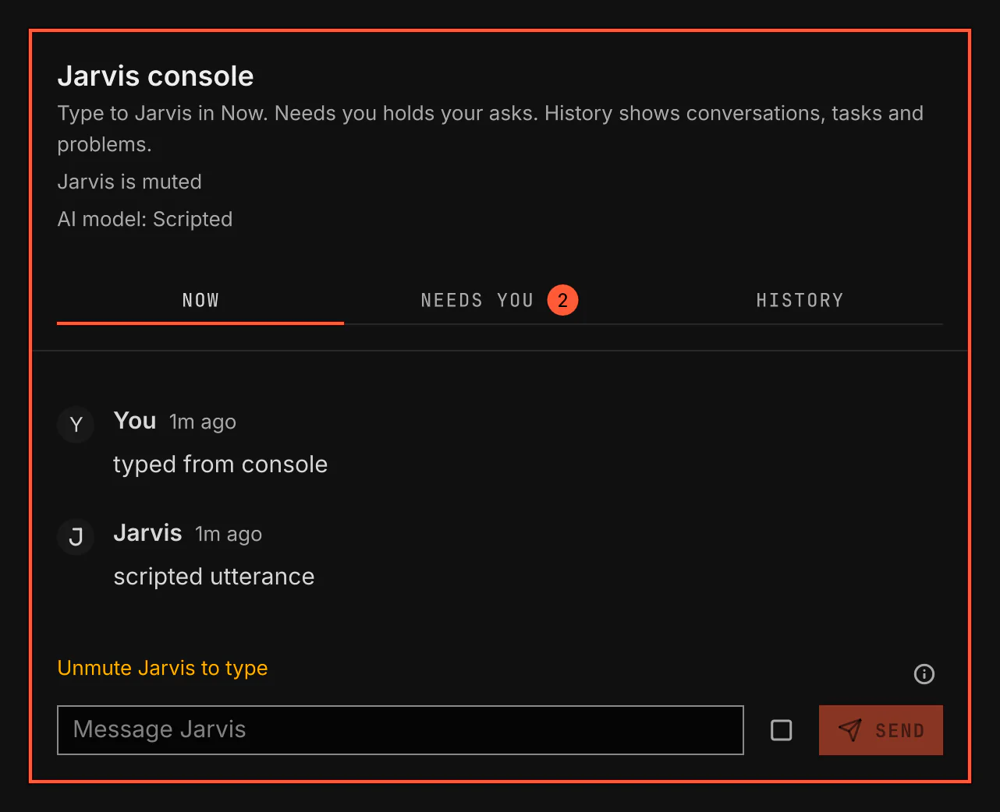
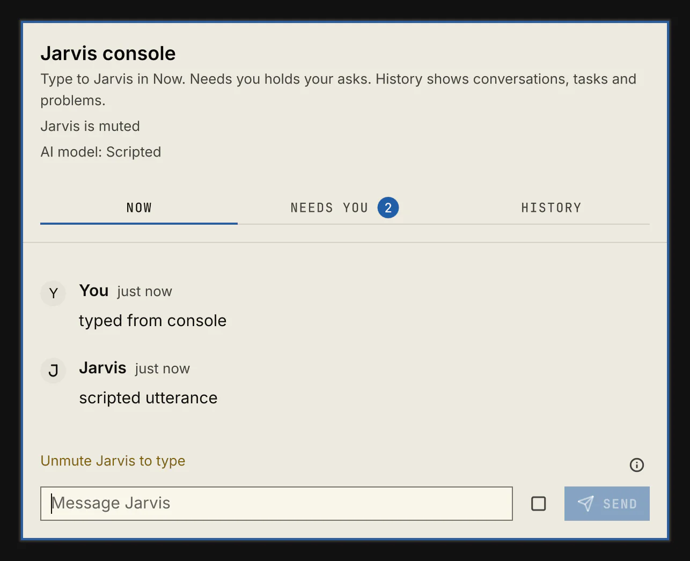

# Jarvis

Jarvis is a voice assistant for your desktop. Talk or type to the AI model you choose, or ask it to work with your windows and files. It asks before it deletes a file or submits something in its browser.

## Features

- Press Talk to open a conversation, or choose Hold to talk to use the microphone only while you hold the key.
- Hear and speak on your computer with Local voice.
- Choose OpenAI Realtime, Gemini Live or ElevenLabs for cloud voice.
- Speak in a voice recorded on your computer after cloned-voice setup.
- Use Claude Code, Codex, GitHub Copilot, Pi or an AI provider key, with backup models.
- Change volume or workspace with short spoken commands.
- Work with windows, applications, files, clipboard, media and notifications.
- Read your screen with private windows hidden, and run commands in a sandbox.
- Use a private browser that asks before it submits.
- Read conversations, coding tasks and refused actions in the Console.
- Share your instructions, skills and memory notes with every answering AI model.
- Start or resume your Jarvis session and send it confirmed agent fleet requests. On another computer, forward them to your main Jarvis.
- Keep provider keys in your desktop keyring.
- Mute Jarvis's voice and read its replies on screen.

## How it works

Jarvis uses your chosen voice provider to hear you and speak the answer. The AI model reads your instructions, skills and memory notes from your Home folder. Jarvis checks actions before it runs them. Agent fleet requests go to your Jarvis session after you confirm them.

Your request goes to the AI model you choose, over the network when that model runs elsewhere. Local voice keeps speech on your computer. OpenAI Realtime sends speech to OpenAI; Gemini Live sends speech to Google. With ElevenLabs, Local voice hears you on your computer, and ElevenLabs receives the reply text to turn into speech. ElevenLabs may keep request history and use data for model training. To stop new data being used for training, open Terms and privacy → Data use in your account ([ElevenLabs help](https://elevenlabs.io/docs/help-center/legal/is-my-data-used-to-improve-eleven-labs-ai-models)).

## Setup

Jarvis comes with VGS. Open Plugin settings from the launcher and choose Jarvis. On its Settings tab, turn Enabled on if it is off:

1. On Settings, choose an Account under AI model. On Setup, Sign in uses the app's own sign-in; Add key stores a provider key.
2. On Settings, choose a Voice provider. On Setup, use Set up local voice for Local or Add a key for a cloud voice. Choose the cloud Voice key on Settings. Run Check microphone when Setup offers it.
3. When the required Setup steps read Done, tap Talk, Super with J, and speak.

The orb at the bottom of the screen shows while a conversation is open. Its menu and the J's right-click menu let you mute Jarvis's voice, change the system microphone mute, stop current work or open Key hints. Muting the voice leaves replies on screen. Muting the system microphone silences it for other applications too; Talk still opens a conversation.

Click the J in the bar to open the Console. Change shortcuts under Keys on Settings. Turning Enabled off stops Jarvis and its session.

Under the Talk key on Settings, Hold to talk starts unchecked. Press Talk to open the conversation and press it again to close. With Hold to talk checked, hold Talk while you speak; releasing closes the microphone and Jarvis replies while the orb stays. A short tap with no words closes the conversation. Stop interrupts a reply or task and keeps the conversation open.

Screen to cloud chooses Ask, Allow or Never for sending screen images or text outside your computer. Private windows chooses which windows Jarvis paints black before it sends a screenshot. Titles do not reliably identify private browsing.

Home folder holds your instructions, skills and notes. On Setup, use Edit beside Personality to change your instructions. Start or resume your Jarvis session from its Setup row; voice and chat work without that session. Start Jarvis at boot and Session at boot choose whether and how it starts when you sign in.

For agent fleet requests, use Install mail tool on the Agent fleet step. Set Main Jarvis host to This computer where your main Jarvis runs, and to that computer's network name everywhere else. Requests sent to that computer need your confirmation; its answers come in your Slack channel.

Use Optional tools on Setup for missing tools. With GitHub Copilot, turn Copilot Memory off in [GitHub Copilot settings](https://github.com/settings/copilot/features); Details links to that account setting too. Local voice uses the system default microphone, which you can change under Sound in System Settings. Set feedback tones under Sounds in that window.

Cloned voice is optional and starts off. With Local selected, use Set up cloned voice beside Cloned voice on Setup, with your own voice or the speaker's permission. It needs the Large local voice model and an NVIDIA graphics card; the recording and model stay on your computer. ElevenLabs voices you design or clone on its site appear under Voice after you select its key.

## Licence

[MIT](../../../LICENSE). The private-browser skill is [Apache-2.0](backend/skills/browser/LICENSE).
