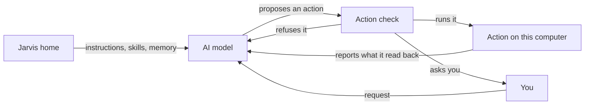

# What can Jarvis Voice's AI model read and do?

Each conversation asks the AI model of the Account you chose: an app you are signed in to, or an API key you added. The model reads your instructions, skills and memory from your Jarvis home. It acts on this computer only through Jarvis Voice's own actions, and each action passes the action check, which runs it, asks you first or refuses it.

## The app and account

Account on Settings names the app or key. An app is Claude Code, Codex, GitHub Copilot or Pi, with the account you signed in to in that app. A key is one you added for an AI provider. Backup models lists the models Jarvis Voice tries in order when the answering app refuses or stops; a backup receives only the last request, not the earlier conversation.

Jarvis Voice runs an app in a private folder of its own, never in your Jarvis home, with the app's own memory and its own tools off. The app reaches this computer only through Jarvis Voice's actions. When the Account is an app, Jarvis, the long-running session, starts with that same app and account.

With OpenAI Realtime or Gemini Live, the cloud voice only hears you and speaks the AI model's words. It reads nothing from your Jarvis home and takes no action.

## What it reads from your Jarvis home

At a conversation's first turn, the AI model receives the Jarvis persona, your `AGENTS.md` instructions, the list of your skills and your memory index. An edit you make to them reaches the next conversation. During the conversation it reads a skill when it needs one, and searches and reads your memory notes. [What belongs in my Jarvis home?](https://github.com/vanillagreencom/kendex/blob/main/skills/jarvis/documentation/HIW-home.md) and [What does Jarvis remember?](https://github.com/vanillagreencom/kendex/blob/main/skills/jarvis/documentation/HIW-memory.md) explain those files.

The AI model can add or replace a memory note. The [Outside memory notes](page:vgs.jarvis/Settings/memoryNotes) setting in Safety controls notes from a turn that read a file, the screen, a web page or an agent's output. Ask first is the default: the note waits in the memory inbox until you choose Confirm or Discard in the Console. Save without asking saves new notes and replacements at once. Both choices keep the note's sources. Notes already waiting still need Confirm or Discard.

## What it does by itself

The AI model works with windows, workspaces, applications, files, the clipboard, media, volume, brightness and notifications. It reads the screen, with Private windows painted black. It runs commands in a sandbox and uses a private browser that has none of your own sign-ins. It starts coding tasks and hands work that needs Jarvis to Jarvis, as [How does Jarvis Voice work with Jarvis?](HIW-jarvis-voice.md) explains. A few short spoken commands, such as changing the volume or the workspace, run without asking the AI model.

File actions reach only your home directory. They never reach your keys and passwords, your browser profiles, your app accounts or VGS's own files, and in your Jarvis home they reach only its `state` folder.

## Web questions and cost

When the conversation already uses your stored OpenAI key, the AI model can answer live web and news questions with one search. The question goes to OpenAI and its search service. The answer includes its sources. Fleet and account requests still go to Jarvis.

Weekly OpenAI spend cap on Settings stops search when Jarvis Voice's counted spend over the last seven days reaches your amount. Voice keeps working. An in-progress search can take the total above the cap. Jarvis Voice keeps usage counts and priced costs in its private audit; a response with missing usage or an unknown price stays unpriced. The report's cost is the priced subtotal, not a claim about unpriced calls or other clients using your key. Your OpenAI dashboard owns the project's separate monthly hard limit.

## The action check

Every action passes one check before it runs, whether the AI model asks for it or the app asks permission for one of its own steps.

| The action | What the check does |
|---|---|
| Reading, and changes you can undo, such as focusing a window, opening an application, playing media or setting the volume | Runs it |
| Writing a new file, moving a file or closing a window | Runs it |
| Typing, pressing keys or clicking in an application | Asks once for that application while the conversation stays open |
| Running a command, starting a coding task, handing work to Jarvis, or submitting in the browser | Asks every time |
| Deleting a file, replacing an existing file, or changing a file that starts programs, such as your shell's startup files or your Hyprland configuration | Asks, and takes only the button or the Confirm key, not your voice |
| Typing into a terminal, VGS, the lock screen, a password prompt or a password field, or an app running its own command outside the sandbox | Refuses |

After a turn reads a file, the screen, a web page or an agent's output, every change, command or typing in that turn asks first, except for [memory notes](#what-it-reads-from-your-jarvis-home), which follow your setting. The question shows on screen. Answer it by voice, with its button, or with the Confirm and Deny keys. A question you leave unanswered for a minute lapses, and the action does not run.

Jarvis Voice reports an action as done only when it reads the effect back. When it cannot tell, it says the result is unknown. [How does Jarvis use my computer and accounts?](https://github.com/vanillagreencom/kendex/blob/main/skills/jarvis/documentation/HIW-tools.md) explains how Jarvis, the long-running session, decides its own actions.

## Your choices

Account and Backup models choose the AI model. Home folder chooses the Jarvis home, and Edit beside Instructions on Setup opens your instructions. Screen to cloud and Private windows choose what a screen read may send. Changing the Account, the Model or the Home folder ends the conversation.

## Related pages

- [How does Jarvis Voice work with Jarvis?](HIW-jarvis-voice.md)
- [How long does Jarvis Voice remember a conversation?](HIW-conversations.md)
- [What leaves my computer when I use Jarvis Voice?](HIW-what-leaves.md)
