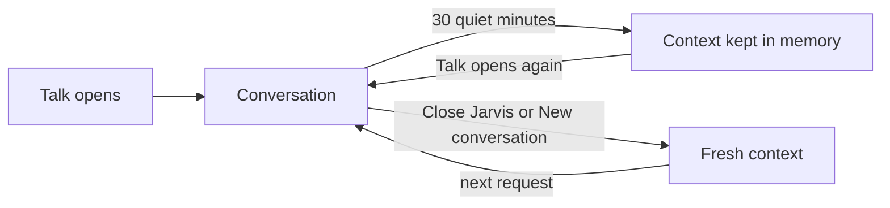

# How long does Jarvis Voice remember a conversation?

When you choose Close Jarvis, your next call starts fresh. Stop interrupts a reply or task and keeps the conversation open. Earlier messages remain available in the Console's History.

## Closing Talk

Press Talk again while listening to finish your recording. Jarvis answers any speech it heard. With Hold to talk on, release the key to finish. A silent recording closes the call, except when answering a confirmation card. Close Jarvis ends the call even while a reply or approval is pending.

After 30 quiet minutes, Jarvis Voice closes the microphone and voice connection automatically. In that case, the next call can continue the context the AI model kept in memory.

## Starting fresh

New conversation, in the J’s menu and the Console, clears the AI model's context and leaves the conversation open or closed as it was. Jarvis Voice shows a notice that it started a fresh conversation.

A conversation holds at most 40 of your turns. Your next message after that starts a fresh context, and Jarvis Voice still answers it. A notice says the conversation reached its memory limit.

A change on Settings to the Account, the Model, the Backup models, the Voice provider or the Home folder ends the conversation, and the next one starts fresh. A restart of VGS or of Jarvis Voice keeps no context, since Jarvis Voice stores none on disk.

## What stays

The Console's History keeps the messages of earlier conversations. Your Jarvis home keeps your instructions, skills and memory notes, and each fresh context reads them again at its first turn. A fresh context never starts from a summary of the earlier conversation.

Jarvis, the long-running session, keeps its own conversation apart from Jarvis Voice. [How does work continue after a restart or handover?](https://github.com/vanillagreencom/kendex/blob/main/skills/jarvis/documentation/HIW-sessions.md) explains how it continues.

## Related pages

- [How does Jarvis Voice work with Jarvis?](HIW-jarvis-voice.md)
- [What can Jarvis Voice's AI model read and do?](HIW-ai-model.md)
