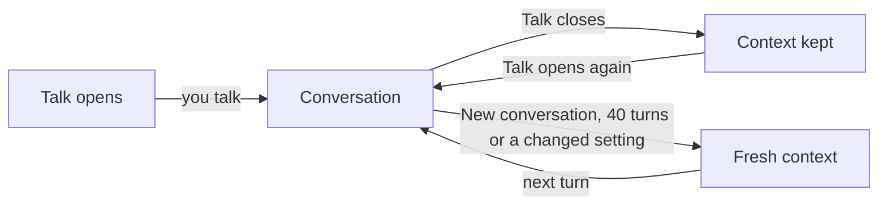

# How long does Jarvis Voice remember a conversation?

Jarvis Voice keeps a conversation's context when you close Talk, so the next Talk carries on where you stopped. It starts fresh when you choose New conversation, after 40 of your turns, when you change the AI model or the Jarvis home, and after VGS or Jarvis Voice restarts. The Console's History keeps the earlier messages in every case.

## Closing Talk

Talk closes the conversation when you press it again, when you tap it briefly and say nothing, or after 30 minutes with no input. Closing turns off the microphone and the voice connection, and the AI model takes no further action. Jarvis Voice keeps the AI model's context in memory. The next time you open Talk, the same AI model continues the same conversation.

Stop is different: it interrupts the current reply or task and keeps the conversation open.

## Starting fresh

New conversation, in the J's menu and the orb's menu, clears the AI model's context and leaves the conversation open or closed as it was. Jarvis Voice shows a notice that it started a fresh conversation.

A conversation holds at most 40 of your turns. Your next message after that starts a fresh context, and Jarvis Voice still answers it. A notice says the conversation reached its memory limit.

A change on Settings to the Account, the Model, the Backup models, the Voice provider or the Home folder ends the conversation, and the next one starts fresh. A restart of VGS or of Jarvis Voice keeps no context, since Jarvis Voice stores none on disk.

## What stays

The Console's History keeps the messages of earlier conversations. Your Jarvis home keeps your instructions, skills and memory notes, and each fresh context reads them again at its first turn. A fresh context never starts from a summary of the earlier conversation.

Jarvis, the long-running session, keeps its own conversation apart from Jarvis Voice. [How does work continue after a restart or handover?](https://github.com/vanillagreencom/kendex/blob/main/skills/jarvis/documentation/HIW-sessions.md) explains how it continues.

## Related pages

- [How does Jarvis Voice work with Jarvis?](HIW-jarvis-voice.md)
- [What can Jarvis Voice's AI model read and do?](HIW-ai-model.md)
