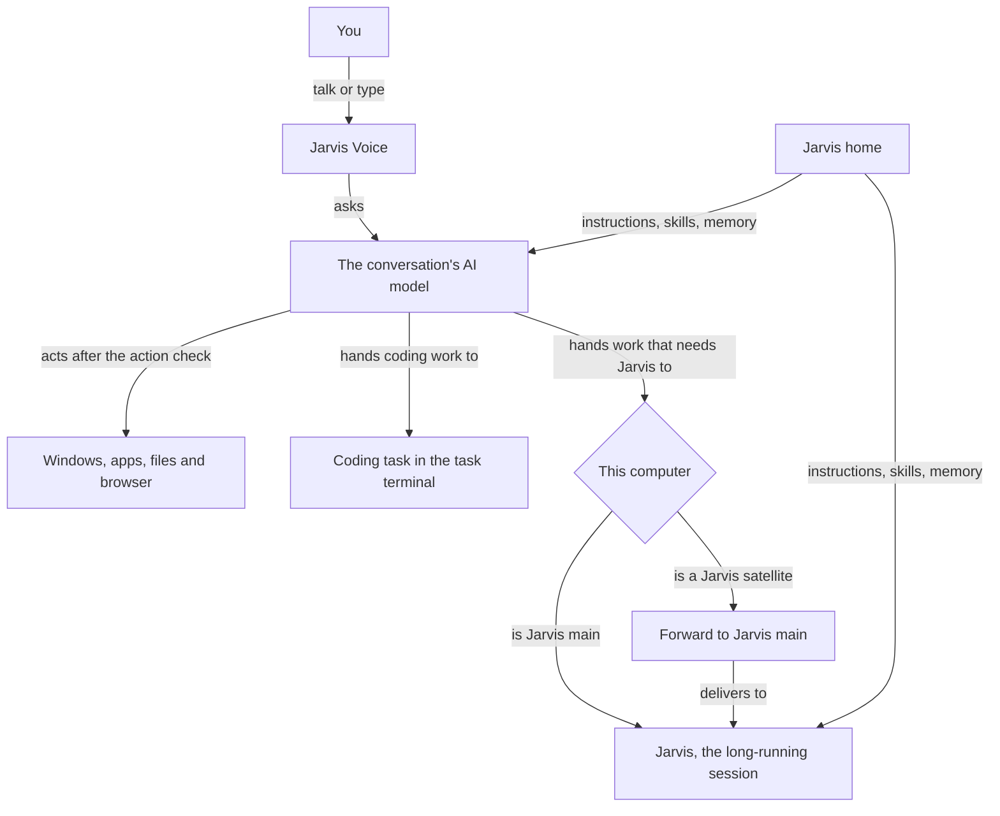

# How does Jarvis Voice work with Jarvis?

Jarvis Voice is the voice session this plugin runs on your computer. Each conversation has its own AI model, which reads your Jarvis home, answers you and acts on this computer after the action check. Jarvis also runs as a long-running session. Work that needs that session goes to it, on Jarvis main or, from a Jarvis satellite, by a forward.

## The conversation

Talk opens a conversation. You speak, or type in the Console. Jarvis Voice asks the AI model of the Account you chose on Settings. That model holds only this conversation, separate from Jarvis's long-running session. Voice and typing work whether that session runs or not. [What can Jarvis Voice's AI model read and do?](HIW-ai-model.md) explains the model and the action check.

## Who does the work

The conversation's AI model does work on this computer itself: windows, applications, files, the clipboard, media, notifications, reading the screen, commands in a sandbox, the private browser and memory notes. Each action passes the action check first.

Coding work goes to a coding task. The task runs on this computer, in the terminal that Task terminal on Settings chooses, on Jarvis main and on a Jarvis satellite alike. You confirm its folder, agent and permission mode before it starts. The Console lists each task, and Jarvis Voice tells you when the agent reports done or failed, or stops and waits.

Work that needs Jarvis goes to Jarvis, after you confirm it. A request to your agent fleet or about one of your accounts is one example. On Jarvis main, Jarvis Voice puts the request in Jarvis's mailbox and says "Let me check my main brain for that." In speech, Jarvis Voice calls Jarvis's long-running session "my main brain". Jarvis acts on it when it next reads its mail. On a Jarvis satellite, Jarvis Voice forwards the request to Jarvis main instead: [How does a Jarvis satellite reach Jarvis main?](HIW-satellite.md) explains the forward. Jarvis then works under its own rules, which [How does Jarvis use my computer and accounts?](https://github.com/vanillagreencom/kendex/blob/main/skills/jarvis/documentation/HIW-tools.md) explains.

## What each side keeps

Jarvis Voice keeps the conversation's context while the conversation lasts, and the Console's History keeps its messages. [How long does Jarvis Voice remember a conversation?](HIW-conversations.md) explains when it starts fresh.

Jarvis keeps its own conversation, its open work and its handoffs. [How does work continue after a restart or handover?](https://github.com/vanillagreencom/kendex/blob/main/skills/jarvis/documentation/HIW-sessions.md) explains them.

Both read the same Jarvis home, the folder Home folder names. [What belongs in my Jarvis home?](https://github.com/vanillagreencom/kendex/blob/main/skills/jarvis/documentation/HIW-home.md) and [What does Jarvis remember?](https://github.com/vanillagreencom/kendex/blob/main/skills/jarvis/documentation/HIW-memory.md) explain the folder and its notes.

## The answer

On Jarvis main, Jarvis Voice watches for Jarvis's answer to a request it handed over. When a conversation is open, it speaks the answer at the next pause, starting with "From my main brain:". A long answer starts with "From my main brain, in brief:" and gives its opening. Otherwise it shows a notification that Jarvis answered. On a Jarvis satellite, Jarvis main's answer arrives in your Slack channel.

## Your choices

On Settings, Account chooses the AI model's app or key, and Home folder chooses the Jarvis home. Start Jarvis at boot and Session at boot choose how Jarvis starts: [How does Jarvis start when I sign in?](HIW-startup.md) explains them. Main Jarvis host chooses whether this computer is Jarvis main or a Jarvis satellite.

## Related pages

- [What can Jarvis Voice's AI model read and do?](HIW-ai-model.md)
- [How long does Jarvis Voice remember a conversation?](HIW-conversations.md)
- [How does Jarvis start when I sign in?](HIW-startup.md)
- [How does a Jarvis satellite reach Jarvis main?](HIW-satellite.md)
- [What leaves my computer when I use Jarvis Voice?](HIW-what-leaves.md)
- [How do requests and decisions reach Jarvis?](https://github.com/vanillagreencom/kendex/blob/main/skills/jarvis/documentation/HIW-messages.md)
