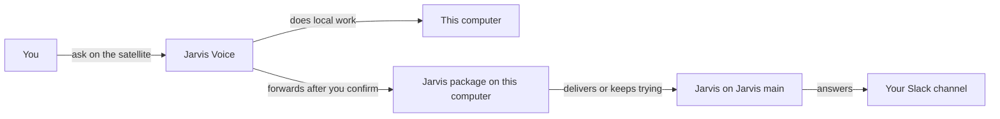

# How does a Jarvis satellite reach Jarvis main?

Jarvis main is the computer that runs Jarvis, the long-running session. A Jarvis satellite is a computer that runs only Jarvis Voice. On a satellite, Jarvis Voice does local work itself and forwards work that needs Jarvis to Jarvis main, each time after you confirm it. Main Jarvis host on Settings says which computer is Jarvis main.

## Choosing Jarvis main

Main Jarvis host is under Home on Settings. On Jarvis main, choose This computer. On every other computer, enter Jarvis main's name as your network knows it, such as `cachy`. When the Jarvis home on Jarvis main has a different path, add a colon and that path after the name.

VGS hands this setting to the Jarvis package in your Jarvis home, so a satellite needs a Jarvis home that the Jarvis package set up. On a satellite, that home is a private copy of the home on Jarvis main. Set Main Jarvis host first, then use Use your Jarvis home from another computer on the Home folder step on Setup. Both computers then read one memory, which only Jarvis main writes, and your keys and passwords stay on Jarvis main. The Console shows whether Jarvis main is reachable, or what keeps a forward from working and where to fix it.

## The forward

On a satellite, Jarvis Voice still does local work itself: windows, applications, files, the screen, the private browser and coding tasks, which run on the satellite in its task terminal. [What can Jarvis Voice's AI model read and do?](HIW-ai-model.md) explains that work.

Work that needs Jarvis goes to Jarvis main. A request to your agent fleet or about one of your accounts is one example. Jarvis Voice shows the request's text and asks you to confirm the forward, every time, by voice or on screen. It then hands the text to the Jarvis package and says "Let me check my main brain for that." In speech, Jarvis Voice calls Jarvis's long-running session "my main brain". The forward carries your request's words only. It does not say who spoke, and your confirmation approves the forward alone, not any action on Jarvis main.

## Memory notes on a satellite

A satellite never writes its own memory. When you ask Jarvis Voice on a satellite to remember something, it forwards your words to Jarvis main as a request, after you confirm it like any forward. It then says it sent the request to Jarvis main, or that it is holding the request and will send it. It never says the note is saved. Jarvis on Jarvis main writes the note in the main home. The satellite reads the note after its copy of the home next pulls the main home's changes. Neither VGS nor the Jarvis package runs that pull, so schedule one yourself, such as an hourly `git pull` of the satellite's home.

## Delivery and the answer

When the package delivers the request, Jarvis Voice says it reached Jarvis main. When the package cannot deliver it yet, the request waits in this computer's outbox, and the Jarvis package keeps sending it while its session runs. Jarvis Voice says the request is queued and not delivered yet, with the cause of the last attempt when the package gives one.

Jarvis on Jarvis main acts on the request under its own rules. The request and Jarvis main's answer appear in your Slack channel. [How do requests and decisions reach Jarvis?](https://github.com/vanillagreencom/kendex/blob/main/skills/jarvis/documentation/HIW-messages.md#a-second-machine) explains a second machine from the Jarvis package's side.

## Related pages

- [How does Jarvis Voice work with Jarvis?](HIW-jarvis-voice.md)
- [How does Jarvis start when I sign in?](HIW-startup.md)
- [What leaves my computer when I use Jarvis Voice?](HIW-what-leaves.md)
