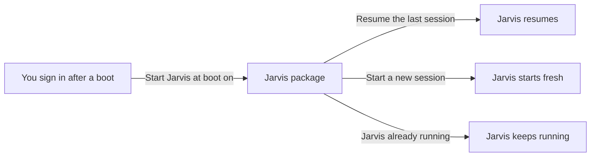

# How does Jarvis start when I sign in?

With Start Jarvis at boot on, VGS asks the Jarvis package in your Jarvis home to start Jarvis, the long-running session, when you sign in after a boot. Session at boot chooses whether Jarvis resumes its last session or starts a new one. Jarvis Voice works with this setting off; only work that needs Jarvis waits for it.

## What starts Jarvis

Start Jarvis at boot is off until you turn it on, on Settings under Home. While it is on, VGS asks the Jarvis package to start Jarvis once each time the computer boots, when VGS first starts after you sign in. The package runs Jarvis in a tmux session in your Jarvis home, with the app and account Account names on Settings. An API key cannot run Jarvis. With Account empty, a resume uses the app and account Jarvis last ran with.

Start on the Jarvis session row of Setup starts Jarvis at any time, with the same choice. Turning Jarvis off with Enabled stops Jarvis, and turning it on again starts Jarvis again.

## Resume or new

Session at boot shows while Start Jarvis at boot is on.

- Resume the last session resumes Jarvis's saved conversation and checks its unfinished work. When that conversation is no longer available, a new session continues the saved work. Resume is the choice until you pick another.
- Start a new session starts a fresh conversation and continues the work saved in your Jarvis home. It erases none of that work.

Neither choice replaces a session that is already running. [How does work continue after a restart or handover?](https://github.com/vanillagreencom/kendex/blob/main/skills/jarvis/documentation/HIW-sessions.md) explains how the package resumes and hands over work.

## When Jarvis cannot start

The Jarvis session row on Setup shows Jarvis's state, its model and when it started. When Jarvis cannot start, the row names the cause and its fix, such as Repair for a damaged package or a link to Home folder. While Start Jarvis at boot is on, a session that could not start at sign-in shows as a warning.

A Jarvis home that VGS made itself has no Jarvis package, so it cannot run Jarvis. Jarvis Voice still works in it. [What belongs in my Jarvis home?](https://github.com/vanillagreencom/kendex/blob/main/skills/jarvis/documentation/HIW-home.md) explains a home that the Jarvis package sets up.

## Your choices

A change to Account or Home folder while Jarvis runs is checked first. When the new choice passes, VGS stops that session and starts Jarvis with the new choice; when it fails, the running session stays and the row names the cause.

## Related pages

- [How does Jarvis Voice work with Jarvis?](HIW-jarvis-voice.md)
- [How does a Jarvis satellite reach Jarvis main?](HIW-satellite.md)
- [How does work continue after a restart or handover?](https://github.com/vanillagreencom/kendex/blob/main/skills/jarvis/documentation/HIW-sessions.md)
