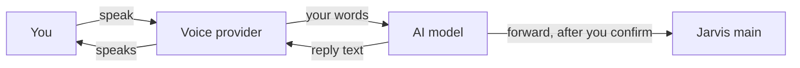

# What leaves my computer when I use Jarvis Voice?

Your request goes to the AI model you choose, over the network when that model runs elsewhere. What the voice provider receives depends on which one you choose: Local voice keeps your speech on your computer, and a cloud voice receives your speech, the reply text or both. A screen image leaves only as Screen to cloud allows, and a forward sends only your request's words to Jarvis main.

## The AI model

The AI model receives your request and the rest of the conversation. It also receives the Jarvis persona, your instructions, skill list and memory index from your Jarvis home, and the notes, files, screen reads and web pages it reads during the conversation. With an app, such as Claude Code or Codex, the app sends this to its own company through its own connection. With a key, Jarvis Voice sends it to the company the key belongs to. A model that runs on your own computer, such as one through Ollama, receives it without the network.

## The voice provider

Local voice keeps speech on your computer. OpenAI Realtime sends speech to OpenAI; Gemini Live sends speech to Google. Each of them also receives the reply text it speaks. With ElevenLabs, Local voice hears you on your computer, and ElevenLabs receives the reply text to turn into speech. ElevenLabs may keep request history and use data for model training. To stop new data being used for training, open Terms and privacy → Data use in your account ([ElevenLabs help](https://elevenlabs.io/docs/help-center/legal/is-my-data-used-to-improve-eleven-labs-ai-models)).

## Screen reads

Screen to cloud on Settings chooses Ask, Allow or Never for sending screen images or text outside your computer. Private windows chooses which windows Jarvis Voice paints black before it sends a screenshot.

## Web search

When OpenAI already receives the conversation through your selected AI account or Realtime voice, Jarvis Voice can send a search question to OpenAI and its search service. It uses that same stored key. A plain spoken question needs no extra approval. A question derived from a file, screen or web page follows the conversation's release choices. The answer keeps its source titles and links.

## Keys and forwards

Your provider keys stay in your desktop keyring. Jarvis Voice sends a key only to the address it was stored for.

On a Jarvis satellite, a forward sends your request's words to Jarvis main through the Jarvis package, after you confirm it. Jarvis Voice refuses a request that looks like it holds a secret. [How does a Jarvis satellite reach Jarvis main?](HIW-satellite.md) explains the forward.

## Your choices

Account and Voice provider on Settings choose who receives your conversation. Screen to cloud and Private windows choose what a screen read may send.

## Related pages

- [How does Jarvis Voice work with Jarvis?](HIW-jarvis-voice.md)
- [What can Jarvis Voice's AI model read and do?](HIW-ai-model.md)
