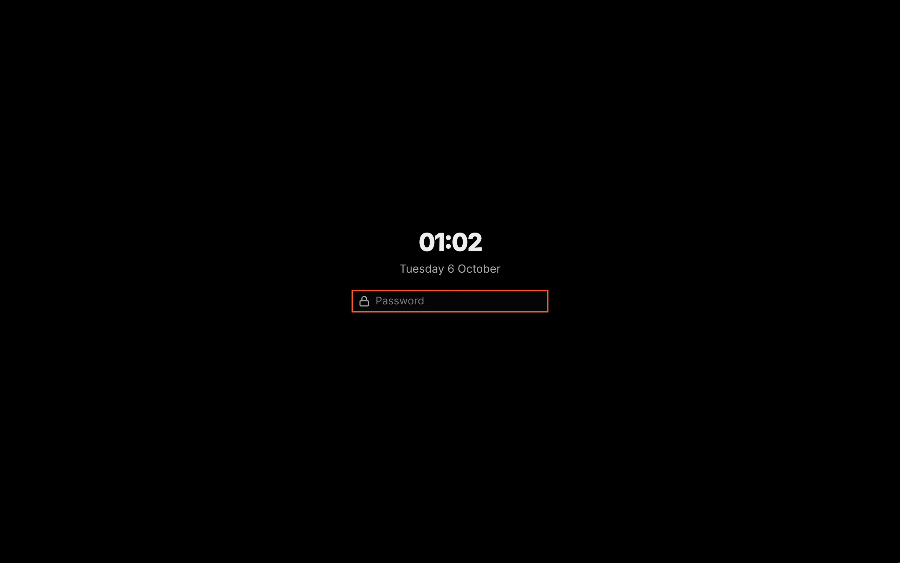

# Lock

Lock protects your session with your password. The lock screen uses your theme and background. While locked, the session stays locked if VGS stops or crashes.

## Features

- Locks with `SUPER+DELETE` or the launcher's Lock row.
- Locks after a time without input, and before the computer sleeps.
- Shows the time, the date and the password field on every screen.
- Pauses the password check for two minutes after ten wrong passwords.
- Can allow temporary password-free access without stopping VGS. This is off until you turn it on.
- Needs no setup. A missing tool installs from the requirement notice in one click.

## Setup

| Setting | What it changes |
| --- | --- |
| Lock when inactive | Time without input before the session locks. Never turns it off. |
| Lock before sleep | Whether the computer waits for the lock before it sleeps. |
| Temporary unlock | Allows any application running as you to request temporary desktop access without a password. Off by default. |

The key is under Keys on the plugin's Settings page.

To allow your delegate to request access, open Settings → Plugins → Lock → Settings and turn on Temporary unlock. VGS cannot tell whether Jarvis sent a request or whether you approved its step. Other applications running as you can use the same permission and can change your VGS settings. Turning the permission off ends active temporary access and requests a lock.

Each request lasts 1 through 60 seconds and cannot extend an active request. The lock key, inactivity and sleep can lock sooner. The Details tab shows whether temporary access is off, allowed or active. An accepted request shows a notification.

VGS must stay running and responsive to lock again. If VGS crashes or stops while deliberately unlocked, the desktop stays unlocked until VGS starts again, which locks it at once. A stall can delay expiry. With Lock before sleep off, sleep can extend access beyond the requested time.

Script authors: [Use temporary desktop access](../../../docs/runbook.md#use-temporary-desktop-access).
