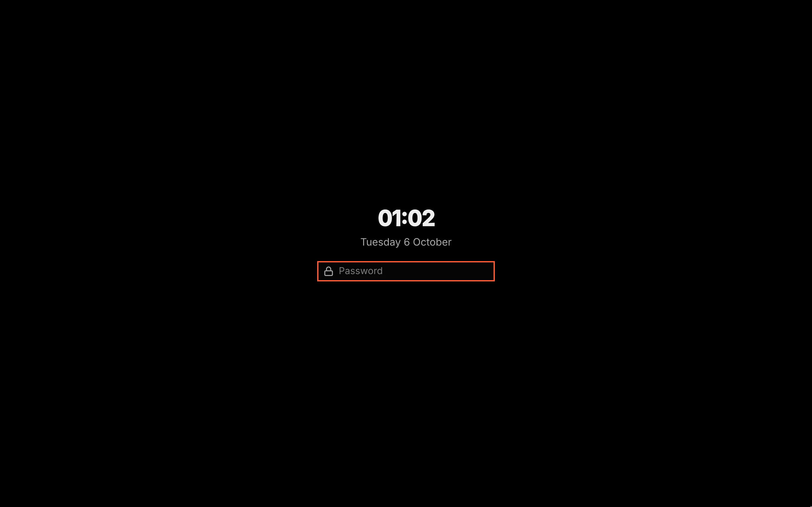

# Lock

Lock protects your session with your password. The lock screen uses your theme and background. While locked, the session stays locked if VGS stops or crashes.



## Features

- Locks with `SUPER+DELETE` or the launcher's Lock row. `vgshell lock` locks the session from a script or an idle daemon.
- Locks after five minutes without input. A playing video that inhibits idle holds it off.
- Locks before the computer sleeps, and the sleep waits for the lock.
- Shows the time, the date and the password field on every screen. Typing on any screen fills every field.
- Pauses the password check for two minutes after ten wrong passwords, and says so.
- Takes over from another lock screen that holds the session. If that lock screen later unlocks the session, the Lock reading on the Details tab warns you.
- Warns you with a notification if the computer slept before the lock was confirmed.
- Locks the session again when the shell starts after a crash while locked.
- Can allow temporary password-free access without stopping VGS. This is off until you enable it.
- Needs no setup. The password check uses the plugin's own PAM stack, and the shell's requirement notice installs a missing tool in one click.

## Settings

| Setting | What it changes |
| --- | --- |
| Lock when inactive | Time without input before the session locks. Never turns it off. |
| Lock before sleep | Whether the computer waits for the lock before it sleeps. |
| Temporary unlock | Allows any application running as you to request temporary desktop access without a password. Off by default. |

The key is under Keys on the plugin's Settings page.

To allow your delegate to request access, open Settings → Plugins → Lock → Settings and turn on Temporary unlock. VGS cannot tell whether Jarvis sent a request or whether you approved its step. Other applications running as you can use the same permission and can change your VGS settings. Turning the permission off ends active temporary access and requests a lock.

Each request lasts 1 through 60 seconds and cannot extend an active request. The lock key, inactivity and sleep can lock sooner. The Details tab shows whether temporary access is off, allowed or active. An accepted request shows a notification.

VGS must stay running and responsive to lock again. If VGS crashes or stops while deliberately unlocked, the desktop can stay unlocked. A stall can delay expiry. With Lock before sleep off, sleep can extend access beyond the requested wall-clock time.

## Script integration

A tool must wait until both lock readings show unlocked before it uses the desktop. It must always request a lock when its step ends, even after an error, and wait until both readings confirm the lock. A refusal or missed transition ends the step. The tool must bound its work within the requested time and must not obtain another grant automatically or restart VGS to recover.

<details>
<summary>Show command</summary>

```sh
vgshell ipc call vgs.lock invoke delegate-unlock '{"seconds":60}'
vgshell ipc call vgs.lock invoke status ''
vgshell ipc call vgs.lock invoke lock ''
```

`seconds` is the only JSON field. It must be an integer from 1 through 60 in an ASCII argument of at most 64 characters. `ok` accepts the request; it does not confirm a compositor transition. Wait for `locked:false` and `secure:false` before the step, then for `locked:true` and `secure:true` after the final lock call. `delegateAllowed` reports the permission and `delegateActive` reports the active window. Refusals leave the lock in place.

</details>
