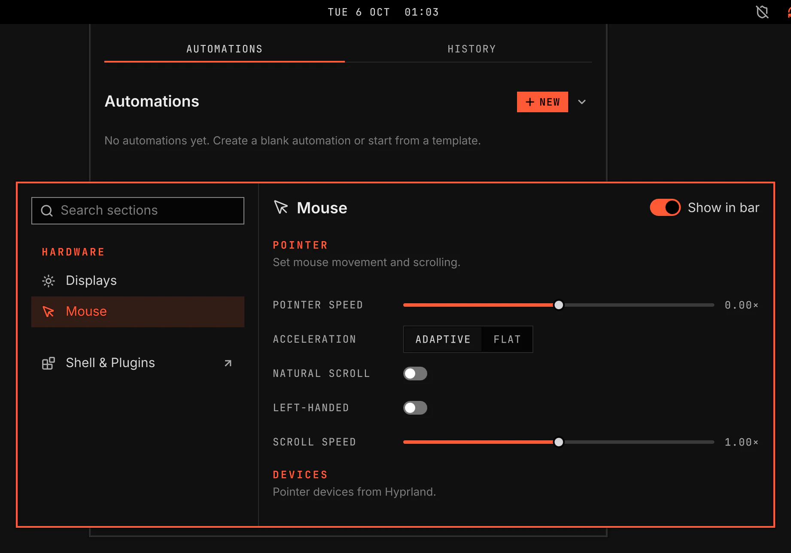

# Mouse

Mouse sets pointer speed, scrolling and touchpad options. It is for anyone who wants to change these without editing a Hyprland file.

## Features

- A bar icon whose flyout holds pointer speed, natural scroll and, when a touchpad exists, the touchpad switch.
- A Mouse section in System Settings with pointer and touchpad settings, your devices and an area to try them.
- Pointer speed, acceleration, scroll speed, natural scroll and left-handed buttons.
- Touchpad on or off, tap to click, two-finger right-click and disable while typing.

## Setup

A setting you change here applies over your own Hyprland config. Where your config sets another value, the row shows it and offers Use my Hyprland value, which makes VGS stop setting it.
