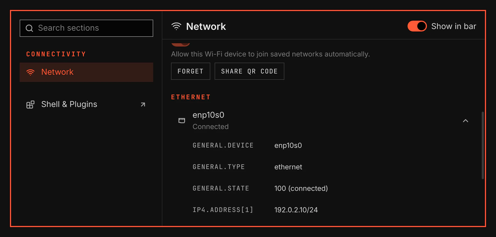

# Network

Network joins Wi-Fi and shows your Wi-Fi and Ethernet connections. It has a bar icon with a dropdown, and a Network section in System Settings.

## Features

- A dropdown under the bar icon with the Wi-Fi switch, the current connection, the networks to join and your Ethernet devices.
- Joins Wi-Fi with a saved password, or asks for one in a masked field.
- Forgets a saved network.
- Turns Wi-Fi and automatic joining on or off.
- Shows the connection details of a device.
- Chooses Cloudflare, Google, the network default or your own DNS servers in System Settings. Each change opens a terminal for review and confirmation. On NixOS, the terminal shows the system configuration instructions.
- Sign in opens a network's sign-in page, such as on hotel or airport Wi-Fi.
- Share QR code joins another device to a saved network. VGS does not keep the QR code.
- Says why when the network service is missing, stopped or refuses access.

## Setup

Show disconnected icon keeps the network icon in the bar while disconnected. When the tool for details or for sharing is missing, Network offers to install it.
