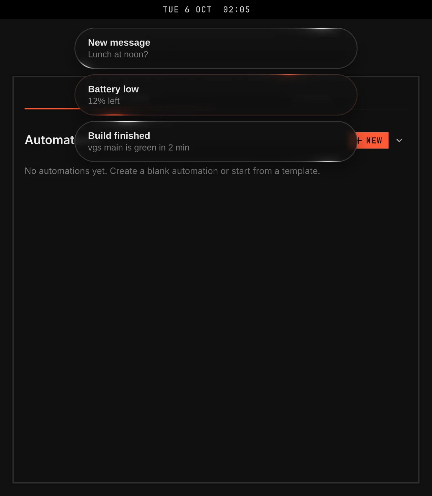
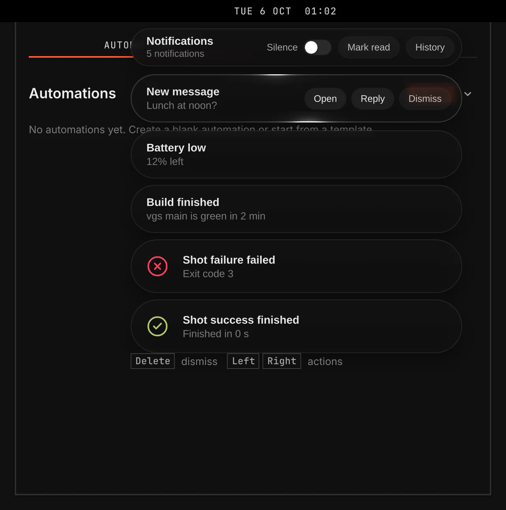

# Notifications

Notifications shows application notifications on each screen and keeps them in a panel to read later. Do Not Disturb keeps new notifications in History without showing them on screen.

## Features

- `SUPER+N` opens and closes the panel of notifications you have not read.
- `SUPER+SHIFT+N` runs the action of your newest notification, also after it leaves the screen.
- `SUPER+CTRL+N` marks every notification as read and closes their popups.
- History keeps notifications for 24 hours, at most the newest 100. Clear history or a restart of the computer empties it.
- Do Not Disturb keeps new notifications off the screen and silent. Critical messages still show.
- The Sound icon turns the VGS notification sound on or off. The sound plays only once you choose one in System Settings → Sounds.
- With Sound off or Do Not Disturb on, an app's own notification sound, such as the Slack chime, is muted too.
- A click runs a notification's main action and brings its app into view.
- A file notification opens the file in your editor, or in the default app for the file.
- Slack notifications show sender initials, workspace icons and custom emoji. See [Slack notifications](slack.md).
- Every VGS plugin's messages show here. With this plugin off, VGS drops them, except right after VGS starts, when another notification app can show them.

## Setup

| Setting | What it changes |
| --- | --- |
| VGlass | Whether notifications draw as frosted glass. Off, they draw as plain panels. VGlass on the Windows page can turn glass on or off for every glass surface, and then this setting has no effect. |
| Notification duration | The minimum time a normal notification stays on screen. A critical one stays until you close it. |
| Position | Where notifications show on each screen. |
| Slack photos | Whether sender photos load from Slack workspaces. |
| Slack custom emoji | Whether custom emoji show in Slack notifications. |

The keys are under Keys on the plugin's Settings page. The Tools step on Setup lists required tools, and the Optional tools step there installs the optional ones.

### App sounds

To mute an app's own notification sound, VGS adds a small rule to WirePlumber, the part of your system that routes sound. VGS installs it when the plugin starts. Your audio services load a new or updated rule the next time they start, at the latest when you restart the computer; signing out may leave them running. VGS never restarts them, so calls and other sound continue. Until then, System Settings → Notifications shows that muting starts after a restart. If your audio services start with the rule and do not load it, it shows that notification sound muting is unavailable.

While Sound is off or Do Not Disturb is on, a call or media that an app starts plays silent for its first second. If a notification from that app comes in that second, it stays silent until it pauses, at most 15 seconds. Sounds that VGS plays itself still play. Turning the plugin off removes the rule.

### Slack photos

Turn on Slack photos in Settings to add sender photos, workspace icons and custom emoji. Each workspace you are signed in to in the Slack desktop app has its own row under Slack photos, and each needs its own User OAuth Token.

Select Create Slack app on the workspace's row. It opens the row's masked field, ready for the token, and the guide for that workspace. The guide explains the permissions before you select Open Slack. VGS fills the Slack app details in your browser. Follow the numbered steps to choose the workspace, create and install the app, then copy its User OAuth Token. If the browser does not open, select Retry opening, Continue in browser to keep reading the steps, or Cancel. App approval needed explains what to ask your workspace administrator.

Select Return to Notifications. Paste the token into the workspace's masked field and select Save. VGS stores it in your keyring, and the row reads Saved. Saved means the token is stored, not that Slack accepted it: the photos load after each token change. If you already have the token, paste it without opening the guide. Replace beside a saved token replaces it, and Remove removes it. If no workspace row appears, sign in to the workspace in the Slack desktop app, then turn Notifications off and on.

The app requests read-only access to sender photos, workspace details and custom emoji. It does not request message or channel access. The guide takes no token. Cancel leaves your settings and saved tokens unchanged.

With Slack photos off, VGS checks whether tokens are present but reads no token and calls no Slack API. Notifications keep sender initials, workspace icons and emoji that Slack has saved.

Developer details: [Developer reference](developer.md).
