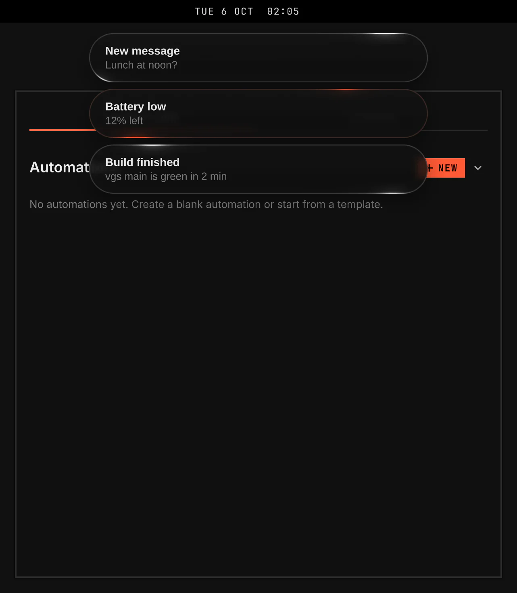
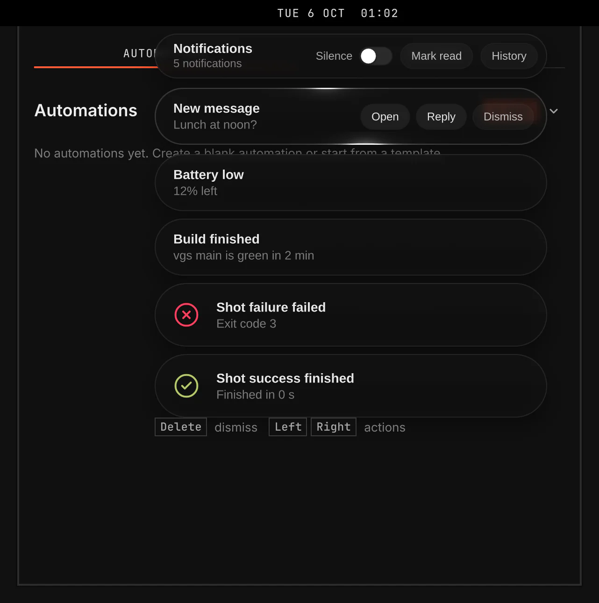

# Notifications

Notifications shows application notifications on each screen and keeps them in a panel to read later. Do Not Disturb keeps new notifications in History without showing them on screen.

VGS uses a summoned panel to give the list keyboard focus.

## Features

- Super+N opens and closes the panel. Escape closes it too.
- Super+Shift+N does what a click on the newest notification you have not dismissed in the panel does, also after it leaves the screen. A notification with no action shows No action. Change or clear both keys under Keys on the plugin's Settings page.
- Super+Ctrl+N marks every notification as read, closes their popups and the panel, and keeps them in History.
- The panel shows the notifications received since the last Mark all read that you have not dismissed there. The History icon shows the saved ones, and shows the unread ones again.
- History keeps every notification that leaves the screen for 24 hours, at most the newest 100, and shows every one. Clear history or a restart of the computer removes them sooner.
- Mark all read marks every notification as read, closes every popup on screen and closes the panel; the History keeps them all. Clear history removes the saved ones.
- The Do Not Disturb icon keeps new notifications in History without showing them on screen. They play no VGS sound.
- The Sound icon turns the VGS notification sound on or off. The sound plays only when you select one in System Settings → Sounds.
- With Sound off or Do Not Disturb on, the sound an app plays for its own notification, such as the Slack chime, is muted too, from its first moment. The app's calls and media keep playing, but one that starts while either is on is silent for its first second. If a notification from that app comes in that second, the call or media stays silent until it pauses, at most 15 seconds.
- For that, VGS adds a small rule to WirePlumber, the part of your system that routes sound. The rule holds a new sound from an app with notifications silent before it plays. If no notification from that app comes within one second, VGS lets the sound play, such as a call. VGS adds the rule when the plugin starts and restarts WirePlumber once on its own so the rule takes effect, which can interrupt sound for a moment. The rule sends a held sound to a silent output named VGS notification mute hold. That output lasts while the rule runs, so it is ready before a sound starts, and never becomes the default output. VGS keeps no saved mute, volume or target for this output. An app keeps its own volume and returns to its normal output when the hold ends, even if the shell stops. With Sound on and Do Not Disturb off, the rule holds nothing. Turning the plugin off removes the installed rule and releases its holds. The silent output disappears when WirePlumber unloads the rule. Sounds that VGS plays itself, such as Test on the Sounds page, still play.
- A normal notification stays on screen for at least the Notification duration. A critical one stays until closed. Pointing at a notification pauses its timer.
- Pointing at a notification shows its actions. A click runs its main action, such as View in Slack, and brings the application's window into view. An action removes the notification from the screen. Dismiss, or a right click, removes it from the screen.
- Enter opens the selected notification in the panel, which keeps it. Delete, or Dismiss on its card, removes it from the Inbox and keeps it in History. In History, the same removes it for good.
- A file notification opens the file in your editor, or in the default app for the file.
- Slack notifications show sender initials and workspace icons without setup. Custom emoji appear when Slack has saved their images. See [Slack notifications](slack.md).
- The panel says so when the saved history cannot be read. Clear history starts a new one.
- A message from any VGS plugin is a system notification, which this plugin draws. VGS has no toast of its own.
- With this plugin off, VGS drops plugin messages and writes one line to its log. Only before VGS first shows a notification after it starts can another notification app show them.

## Settings

| Setting | What it changes |
| --- | --- |
| VGlass | Whether notifications draw as frosted glass with a moving edge light, and enter from a glass bead. Off, they draw as plain panels that fade in and out. On by default. VGlass in the Windows page can turn glass on or off for every glass surface, and then this setting has no effect. |
| Notification duration | The minimum time a normal notification stays on screen. |
| Position | Where notifications show on each screen: top or bottom, at the left, center or right. The newest notification is nearest that edge. |
| Slack photos | Whether sender photos load from connected Slack workspaces. |
| Slack custom emoji | Whether custom emoji show in Slack notifications. |

The shortcut is under Keys on the plugin's Settings page. The Tools step on Setup lists required tools, and the Optional tools step there installs the optional ones. Details lists the optional tools under Tools.

## Slack photos

Turn on Slack photos in Settings to add sender photos, workspace icons and custom emoji. Each workspace needs its own Slack app user token.

Select Set up Slack photos on the Details tab. VGS opens Slack app creation with the app details filled. Sign in to Slack if asked. Select your workspace. Review the permissions, then select Create. Under OAuth & Permissions, install the app to the workspace and allow access. Copy the User OAuth Token.

Sign in to the workspace in the Slack desktop app. Return to the Settings tab and, under Slack tokens, select Add key for the workspace. Paste the token into the masked field. VGS stores it in your keyring. Replace beside a stored token replaces it, and Remove removes it. The photos load after each token change. If your workspace requires app approval, ask its administrator to approve the app.

Show details in the setup window displays the app text. The app requests only the permissions needed for photos, workspace icons and custom emoji. It does not read messages or channels.

With Slack photos off, VGS checks whether tokens are present but reads no token and calls no Slack API. Notifications keep sender initials, workspace icons and emoji that Slack has saved.

Developer details: [Developer reference](developer.md).
