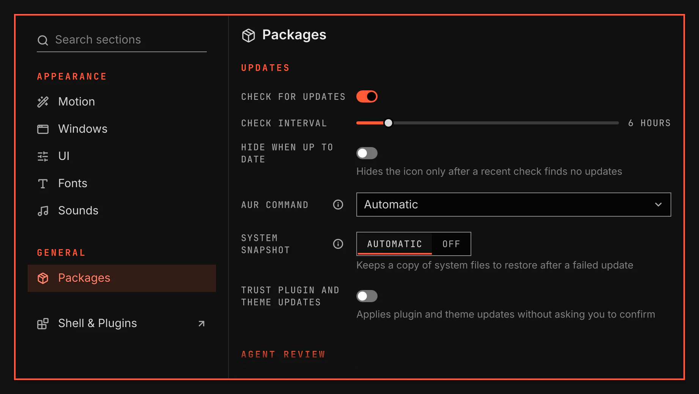

# Packages

Choose how VGS checks for updates and offers an AI review before a package installs or updates. Open General > Packages in System Settings, or Package review settings in the launcher. Packages and System Settings stay on.

## Features

- Change the same update options shown on the Updates plugin's Settings page.
- Choose what VGS does before an install or update: Review with an agent and Automatic ask first; Install without review uses “Install without asking, except with a custom AUR command.”
- Choose the AI agent, or let VGS use one available on this computer.
- Set an optional review command instead of the selected agent's default.

## Licence

[MIT](../../../LICENSE)
