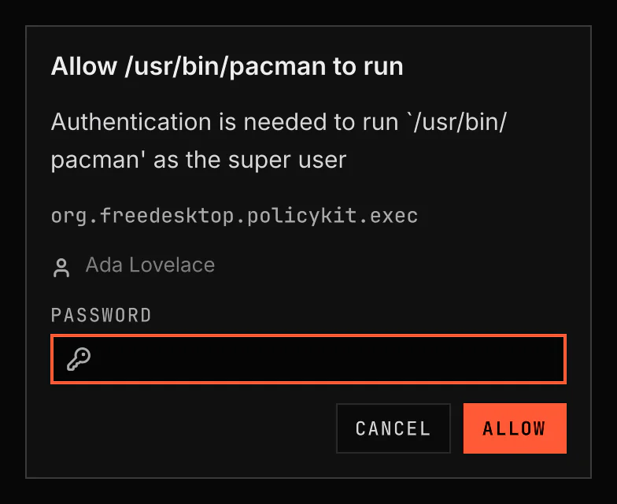

# Polkit

Polkit asks for your password when an application needs administrator access. The prompt uses your theme.

## Features

- A dialog over a dimmed screen with the request's message, its polkit action, the account it authenticates as and the password field.
- A choice of account when the request accepts several, such as every member of an administrators' group. Tab and Shift+Tab reach it from the keyboard.
- Enter or Allow submits the password. Escape or Cancel denies the request.
- A wrong password, and every message PAM sends, shows under the field. The dialog then asks again.
- The password is cleared from the field as soon as it is sent.

## Setup

Open Settings → Plugins → Polkit → Setup and check Password prompts. Only one app can show these prompts at a time. If another app handles them, VGS names it and offers Uninstall, or Stop when another installed app needs it.

If Polkit is missing, select Review all missing or outdated tools on Password prompts or Tools. Not available explains what to try when VGS cannot check or show prompts. After a successful setup action, VGS can show prompts without a new login.
