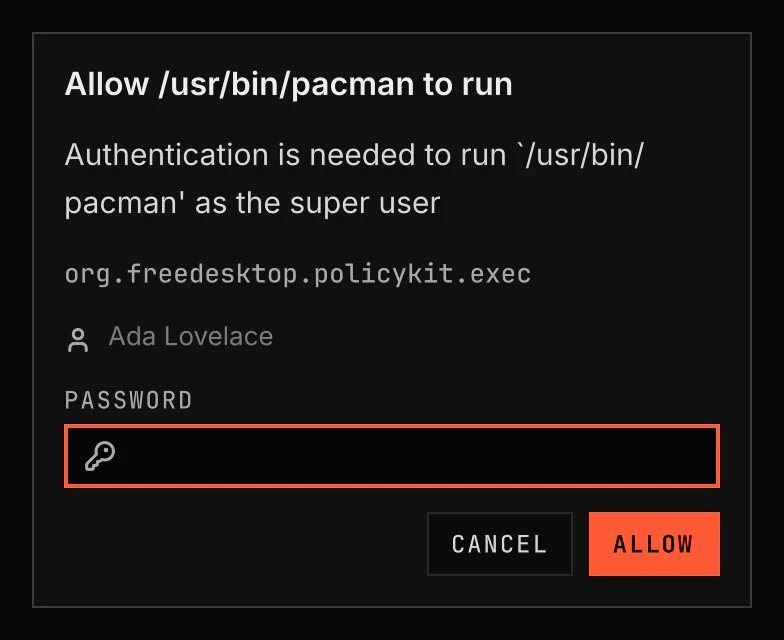

# Polkit

Polkit asks for your password when an application needs administrator access. The prompt uses your theme.

## Features

- A dialog over a dimmed screen with the request's message, its polkit action, the account it authenticates as and the password field.
- A choice of account when the request accepts several, such as every member of an administrators' group. Tab and Shift+Tab reach it from the keyboard.
- Enter or Allow submits the password. Escape or Cancel denies the request.
- A wrong password, and every message PAM sends, shows under the field. The dialog then asks again.
- The password is cleared from the field as soon as it is sent.

## Setup

The plugin ships with VGS and is on by default. Only one app at a time can show password prompts. The Password prompts step on the Setup tab shows whether VGS can show them. When another app shows them, the page names it and offers Uninstall, or Stop when another installed app needs it. Polkit is a required tool. When it is not installed, select Review all missing or outdated tools on the Password prompts step or the Tools step. When VGS could not check for another app, or prompts do not work with no other app in the way, the step reads Not available and says what to try. After Uninstall, Stop or the install, VGS shows password prompts at once, with no new login.
