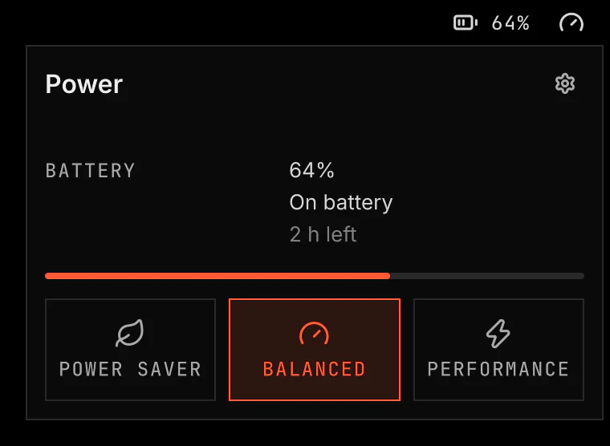
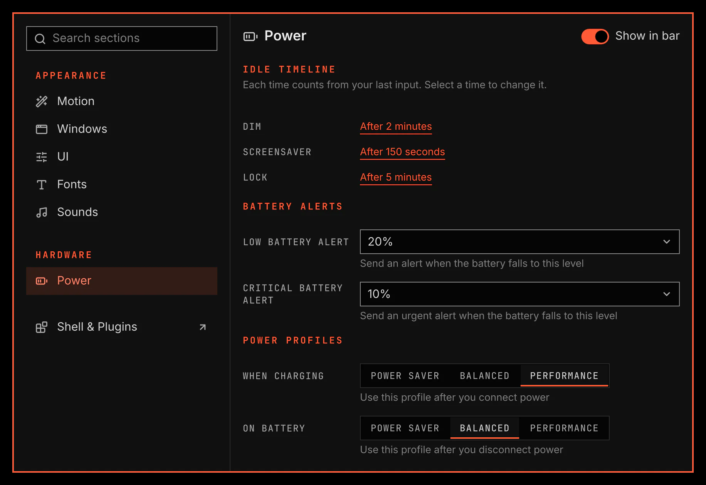

# Power

Power shows the battery level and the power profile in the bar, and switches the profile. Its section in System Settings, under Hardware, shows what the computer does when you stop using it. It is for laptops and desktops.

## Features

- A bar icon with the battery level and the active power profile. On a desktop it shows the profile alone, and it hides when profile control is unavailable too.
- A flyout with the battery level, the charging state, the time estimate and the power profiles.
- Use power saver, Use balanced and Use performance in the launcher.
- With a battery, switches to the profile you choose when you connect or disconnect power. It leaves the profile alone when VGS starts.
- Sends a low battery alert and an urgent critical alert, each once per discharge.
- Performance is unavailable on hardware without a performance profile.
- An idle timeline in System Settings: each step, such as dim, screensaver and lock, in order with its time. Select a time to open the field that sets it. A step that starts before an earlier step shows a warning, such as a lock before the screensaver.

## Settings

The battery rows show only on a machine with a battery. The two profile rows also need the power profiles service, which is optional: without it, Power's section in System Settings offers to install it. Wake on LAN shows only on a machine with a wired network device that NetworkManager manages. Without a battery, Power sets one profile from the bar, and Details says so. The same settings show in Power's section of System Settings. If Power cannot save Wake on LAN, only that section shows the problem, under the switch.

| Setting | What it changes |
| --- | --- |
| Low battery alert | The battery level that sends an alert while discharging. |
| Critical battery alert | The battery level that sends an urgent alert while discharging. |
| When charging | The profile to use after you connect power. |
| On battery | The profile to use after you disconnect power. |
| Wake on LAN | Whether another device on the wired network can wake the computer from sleep. Power changes your wired connections only after you set this switch. Then it saves the value on every wired connection and, while it is on, on a connection added later. A connection in use takes it the next time it connects. When you turn Power off, the wired connections keep the last value, so turn Wake on LAN off first. |
