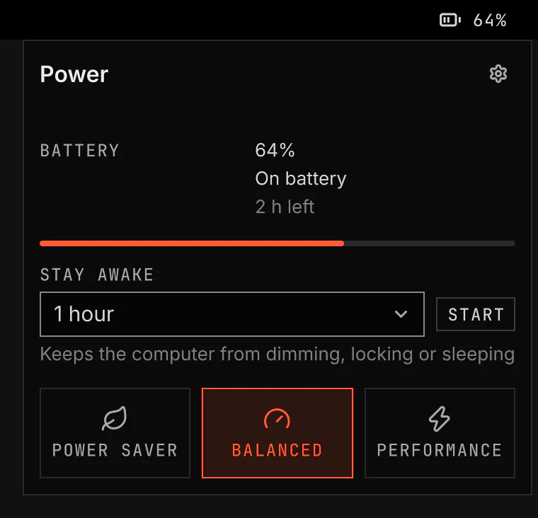
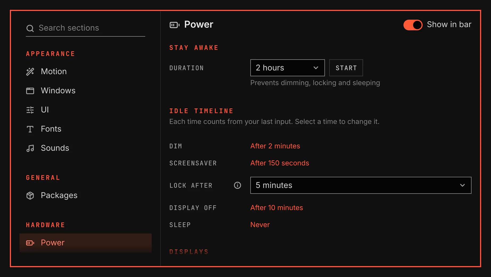

# Power

Power shows the battery level in the bar, or the power profile on a computer with no battery, switches the profile and keeps the computer awake for a time you choose. Its section in System Settings, under Hardware, shows what the computer does when you stop using it. It is for laptops and desktops.





## Features

- A bar icon and flyout with the battery level, the charging state, the time left and the power profiles.
- Power saver, balanced and, where the hardware has it, performance profiles, also from the launcher.
- A profile of your choice when you connect or disconnect power.
- A low battery alert and an urgent critical alert.
- Stay awake, in the flyout and in Power's section: keeps the computer from dimming, locking or sleeping for 30 minutes, 1 hour, 2 hours, 4 hours or until you turn it off. A cup shows in the bar while it is on. It ends at its time, when you select End, when the battery reaches the critical alert level or when the shell restarts, and it changes none of your idle or sleep settings. The flyout offers the duration you used last.
- An idle timeline in System Settings: dimming, the screensaver, the lock, the displays turning off and sleep, in order, each with its time.
- Turns the displays off after you stop using the computer, and sooner while the screen is locked.
- A power menu to log out, suspend, hibernate, reboot, shut down or switch user. Hold an action for 2 seconds to run it. Open the menu from the launcher's System menu, or choose its key under Keys in Power's Settings.
- Wake on LAN for a wired network device that NetworkManager manages.

## Setup

Wake sources, a required step on the plugin's Setup tab, lets only keyboards and pointing devices wake the computer through USB or Bluetooth. The power button and a USB device you connect during sleep also wake it. Allow opens a terminal that asks for your password.

<details><summary>Show command</summary>

```bash
vgshell system apply wake-sources
```

</details>

The battery rows show only on a computer with a battery. The profiles need the power profiles service; without it, Power's section in System Settings offers to install it. The same settings show in Power's section of System Settings.

| Setting | What it changes |
| --- | --- |
| Turn displays off | How long the displays stay on without input. |
| Low battery alert | The battery level that sends an alert. |
| Critical battery alert | The battery level that sends an urgent alert. |
| When charging | The profile to use after you connect power. |
| On battery | The profile to use after you disconnect power. |
| Show profile in bar | Whether the bar shows the power profile beside the battery level. |
| Wake on LAN | Whether another device on the wired network can wake the computer from sleep. |

Power changes your wired connections only after you set Wake on LAN. When you turn the Power plugin off, the wired connections keep the last value, so turn Wake on LAN off first.
