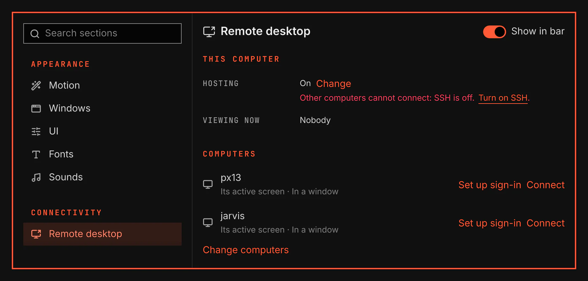

# Remote desktop

Remote desktop opens the desktop of your other computers in a window, and shows in the bar when another computer views this one. It connects over SSH with no separate account or pairing.

## Features

- A red screen icon in the bar while another computer views this desktop. Its tooltip names that computer and its address.
- One entry per computer, each with its own screen, window, video, picture, bitrate, capture, clipboard and release keys.
- Connect opens a computer in one click, from System Settings › Remote desktop or from the launcher, which lists Connect to each computer.
- The first time it starts, the list holds the computers your SSH settings name and that you signed in to before.
- Hosting off turns off remote desktop to this computer; SSH stays as it is. While it is off, Hyprland refuses the screen to gliff, and VGS ends each session it finds.

A window your Hyprland configuration marks `no_screen_share` stays hidden in every screen capture, a remote session included.

Connect sends gliff's own standard output and error output to the system journal under `vgs-gliff`.

## Setup

Both computers need gliff, and the computer you connect to needs SSH on. Open Settings → Plugins → Remote desktop → Setup to install missing tools under Optional tools. SSH on this computer starts the SSH server and keeps it on after a restart when you allow hosting.

In System Settings → Remote desktop, select Set up sign-in beside a computer. The setup window asks before it prepares an SSH key and copies it to that computer. Type the other computer's password and any key passphrase there. VGS does not see or keep them.

Remote desktop cannot ask for a password or key passphrase when it connects. A key with a passphrase needs an SSH agent running in your session; Set up sign-in stops without changing anything if none runs. The setup also stops if only the public half of your default key exists, so it does not replace a key held by an agent or security device.

Connect also offers to install gliff or its journal tool while either is missing. The first time the plugin is on, Hosting off takes full effect after you sign in again, because Hyprland reads its screen capture rules only when it starts. Until then, VGS ends each session it finds while hosting is off.
