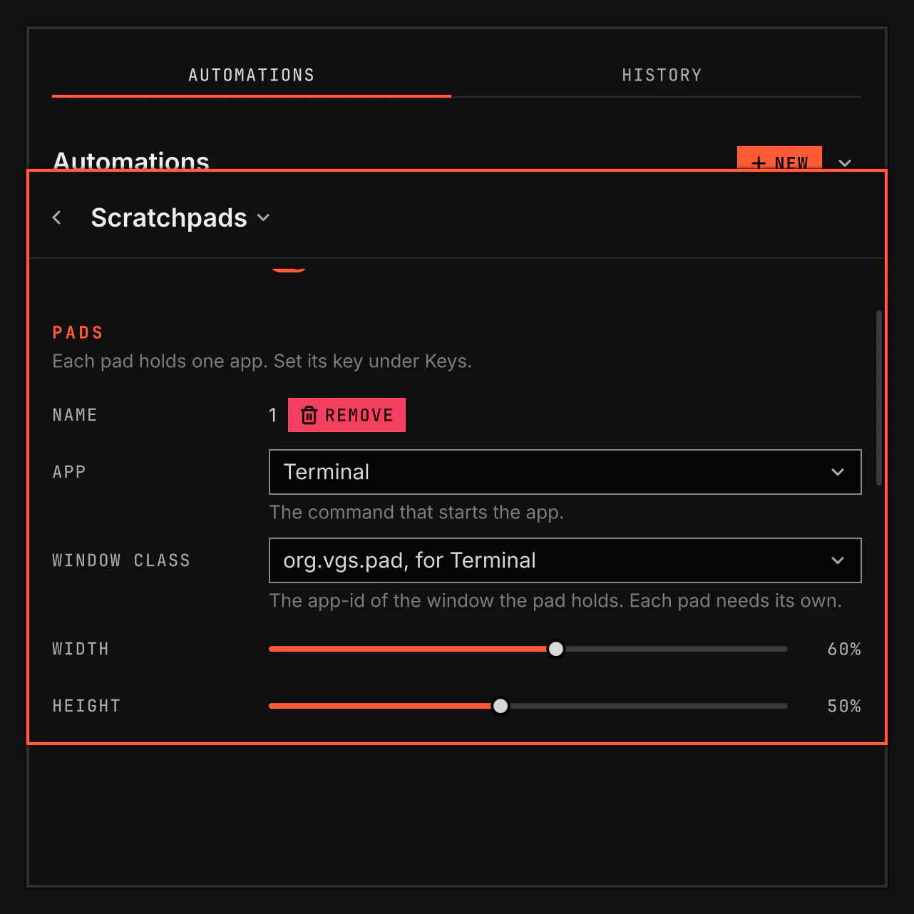

# Scratchpads

Scratchpads shows and hides an app with one key, over whatever you work on. Each pad holds one app at the size, place and screen you set in Plugins.

## Features

- Add, change and remove pads on the Scratchpads page in Plugins. No file to edit.
- One key per pad. A press starts the app if it is not running, then shows it.
- Size as a share of the screen, so one setting fits a laptop panel and a large display.
- A place on the screen, the side it comes in from and how it moves in.
- The focused screen or one screen you choose.
- Start the app at login, so the first press shows it at once.
- Click beside the pad or move to another window to hide it.
- Remove a pad, or turn off Scratchpads, and its app comes to the workspace you are on.

## Setup

A new pad has no key. Set one in the Keys section of the same page.

Each pad needs an App, the command that starts it, and a Window class, the app-id its window opens with. Terminal, Second terminal and Third terminal open your default terminal, each with its own class. Custom takes any command; the app must open its window with the class the pad names, or the pad never shows it. While two pads share a window class, the later one opens nothing, and its key shows a message that says so.
