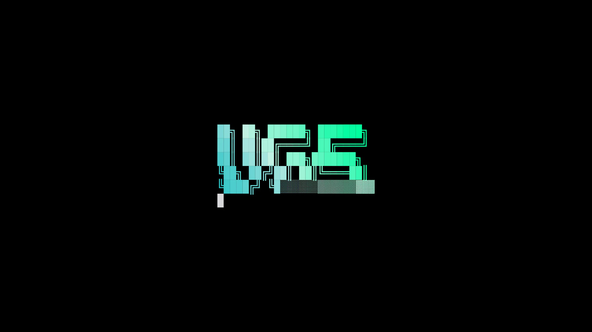

# Screensaver

Screensaver shows animated text art on each screen when the desktop is inactive.

## Features

- Start after an inactive time, from Screensaver in the launcher, or with a key you assign.
- Stop with a key, click or pointer movement.
- Choose a text effect, or let Screensaver choose at random.
- Show the VGS logo, an image converted to text art, or your own text file.

## Setup

Open Plugins > Screensaver to set the inactive time, effect, art and frame rate. Lock after sets the lock's time, which the Lock page and System Settings > Power edit too. Immediately locks when the screensaver starts; it takes the start time it reads when you choose it. Set a shortcut under Keys. For your own art, choose Custom and enter the full path of a PNG or SVG image or a text file.

The screensaver and lock times both count from the start of inactivity. If the session locks after inactivity, the screensaver stays visible. The first key, click or pointer movement then reveals the lock screen without typing into it. Equal times start both together.

Locking the session yourself, putting the computer to sleep or turning the screens off stops the screensaver.

## Licence

MIT. Parts derive from MIT-licensed scripts; [ATTRIBUTION](ATTRIBUTION) carries their notice.
