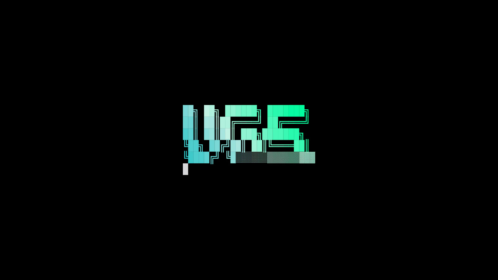

# Screensaver

Screensaver shows animated text art on each screen when the desktop is inactive.

## Features

- Starts after the inactive time you choose, with one cover on each screen.
- Starts on demand from Screensaver in the launcher, or from a key you assign under Keys.
- Stops on keyboard input or pointer movement.
- Stays on screen when the session locks itself after inactivity. The first key, click or pointer movement then shows the lock screen and types nothing into it. When the lock and the screensaver have the same time, both start together.
- Stops when you lock the session yourself, when the computer sleeps and when the screens turn off.
- Random or one named text effect.
- Shows the VGS logo, text art made from a PNG or SVG image, or a text file of your own.
- Shows whether the lock follows the screensaver.

## Settings

| Setting | What it changes |
| --- | --- |
| Start when inactive | Turns the start on inactivity on or off. |
| Start after | The inactive time in seconds. This time and the lock time both count from the start of inactivity. |
| Effect | Random, or one named effect. |
| Art | The VGS logo, or the path of a PNG or SVG image or a text file. |
| Frame rate | How many frames the screensaver draws each second. |

## Licence

MIT. Parts derive from MIT-licensed scripts; [ATTRIBUTION](ATTRIBUTION) carries their notice.
