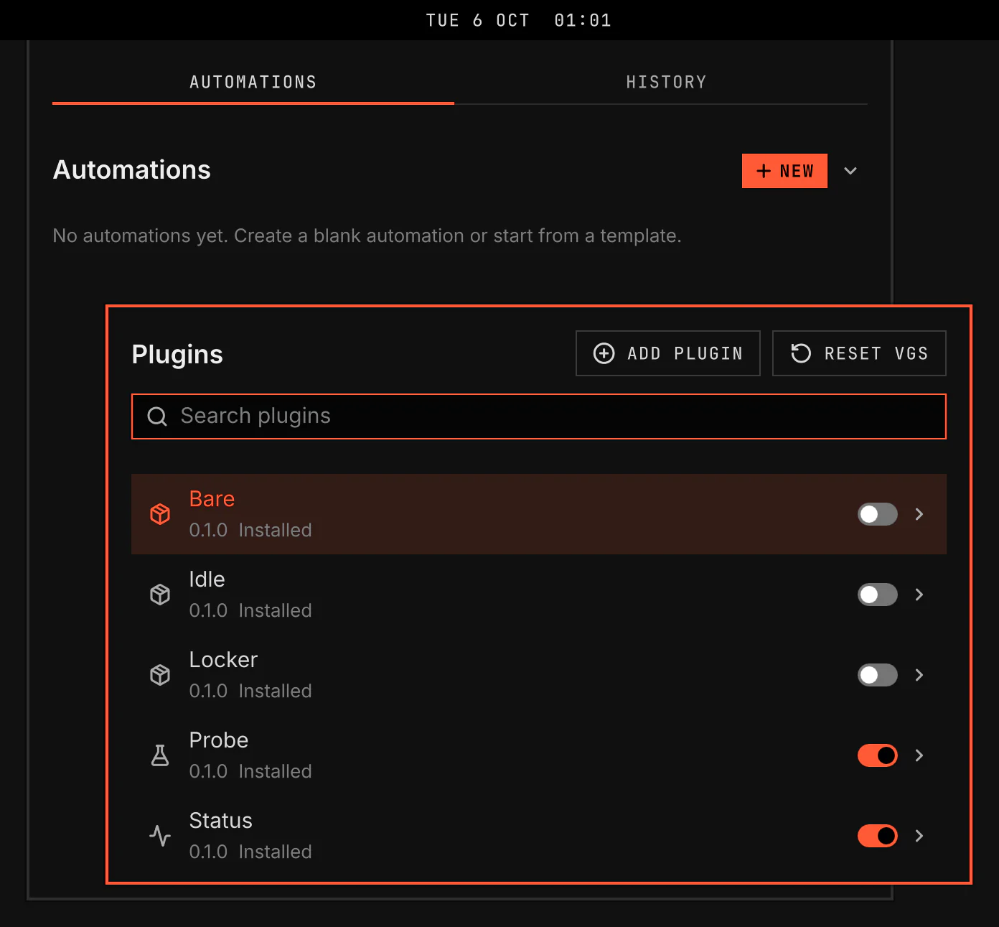

# Plugins

Plugins is the window where you manage your plugins, their settings and their shortcuts. Open it with `SUPER+PERIOD`, the plug in the bar, or Settings > Plugin settings in the launcher. Plugins is always on.

## Features

- Search for a plugin and open its page.
- Turn a plugin on or off. Plugins, System Settings and Packages stay on.
- Show a plugin in the bar, or take it out while its other features stay on.
- Change a plugin's settings and its shortcuts.
- See which plugins need setup, and finish their steps on the Setup tab.
- Store a plugin's keys in a masked field. Your keyring holds them.
- Install a plugin's missing tools in one click.
- Read a plugin's status under Details.
- Add a plugin from its git address, update it with its changes shown first, or remove it.
