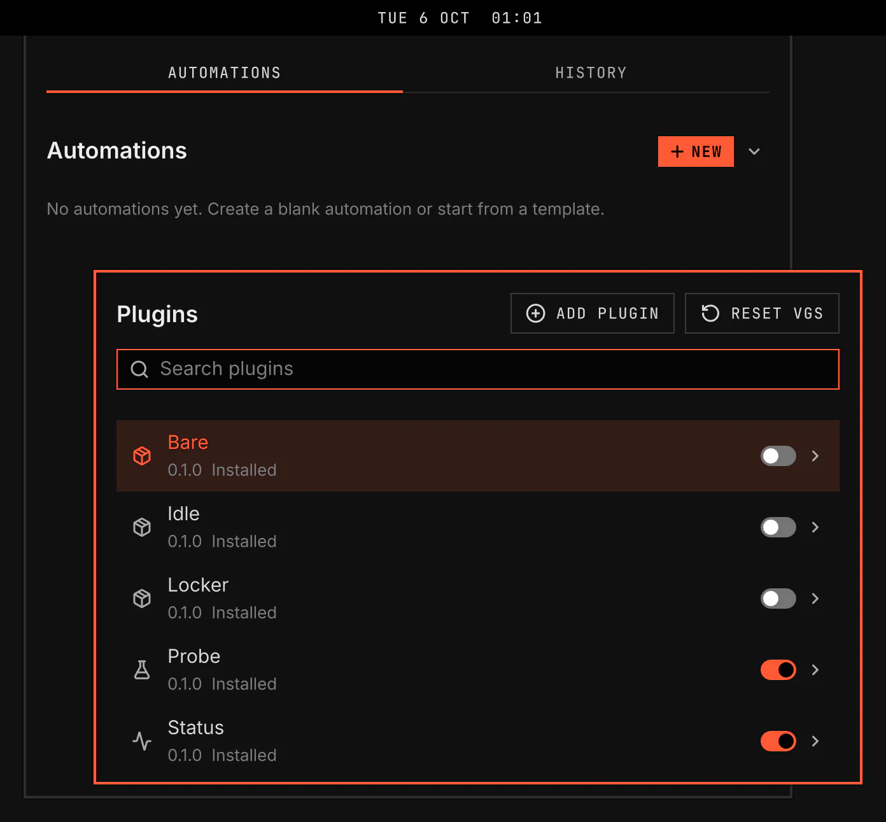

# Plugins

Plugins is the window where you manage your plugins, their settings and their shortcuts. Open it with `SUPER+M`, the plug in the bar, or Settings > Plugin settings in the launcher. Plugins is always on.

## Features

- Search for a plugin and open its page.
- Turn a plugin on or off. Plugins itself stays on.
- Show a plugin in the bar, or take it out while its other features stay on.
- Change a plugin's settings. Under Keys, select a shortcut and press its new keys. A shortcut can have more than one key: the add button listens for another, and Delete removes the one you select. Use my binding keeps one of your own Hyprland binds on the same keys.
- See which plugins need required setup. A plugin that is on shows Setup needed in the list and a warning on its Setup tab until its required steps are done.
- Finish a plugin's required steps under Setup. Each reads Done or To do. Change values under Settings, with a stored key beside the setting it serves. Details holds the readings, each optional feature's action beside its reading, and the optional tools. A required connection keeps its keys on Setup. A masked field takes the key, and your keyring holds it. Review all missing or outdated tools opens the tool notice.
- Read a plugin's status under Details.
- Add a plugin from its git address, update it with its changes shown first, or remove it.
- Escape returns to the list, then closes the window.
