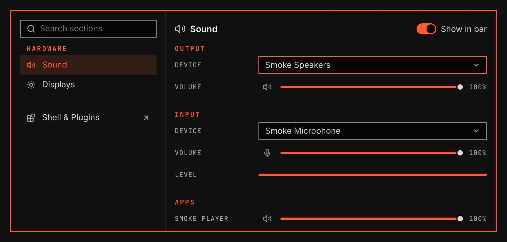

# Sound

Sound sets the volume, the output and input device, and the volume of each app that plays. It adds a bar icon with a flyout, a Sound section in the System Settings window, the volume keys and an on-screen display.

## Features

- A bar icon that shows the output level. A click opens the flyout, the mouse wheel changes the volume and a middle click mutes the output. The tooltip names the output and its level.
- A flyout and a Sound section in the System Settings window with output and input device choices, volume and mute controls, and one volume for each app that plays.
- A live microphone level meter in both views, so you can check the selected input while you speak.
- The volume keys raise, lower and mute the output, and mute the microphone. Each shows an on-screen display on the screen you use.
- Choosing an output makes it the default. The apps that play now move to it.
- While PipeWire is not running, the bar icon shows a crossed speaker. Sound connects again when PipeWire starts.

## Setup

Choose Sound settings in the flyout to open the Sound section of System Settings.

Open Plugins and choose Sound. On its Settings tab, Volume step changes how much the volume keys and mouse wheel adjust the volume. Change shortcuts under Settings/Keys.

Sound uses PipeWire. When `pactl` is missing, choose Install pactl under Playing apps in either Sound view. You can also choose Review all missing or outdated tools on the Tools step of Sound's Setup tab. This tool checks input availability and moves playing apps to the output you choose. Without it, input availability cannot be checked; new apps use the new output, but apps already playing stay where they are.

## Licence

[MIT](../../../LICENSE)
