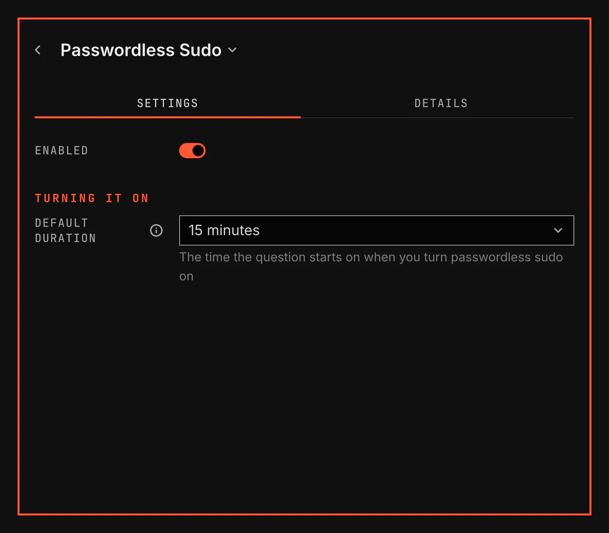

# Passwordless Sudo

Passwordless Sudo puts a lock in the bar. Click it to turn passwordless sudo on for a time you choose, and click it again to turn it off.

While it is on, any program running as you can run anything as root without a password.

## Features

- A closed lock means off. An open lock in the warning colour means on; its tooltip shows when it ends.
- A question mark means VGS cannot read the state.
- Click the closed lock to choose a duration in a terminal and confirm the risk. Indefinitely asks for a second confirmation.
- Click the open lock to turn it off without a confirmation.
- Notifications tell you when you turn it on or off.

## Setup

Open Plugins > Passwordless Sudo to choose the Default duration. Each time you turn it on, you can choose 15 minutes, 1 hour, 1 day or Indefinitely.

The first use also sets up passwordless sudo in the same terminal. Sudo asks for your password.

A timed grant ends at its deadline, or at the next restart if that comes first. Indefinitely stays on after a restart until you turn it off.

On NixOS, the icon is a snowflake. Your system configuration controls passwordless sudo; VGS cannot read or change that rule.
