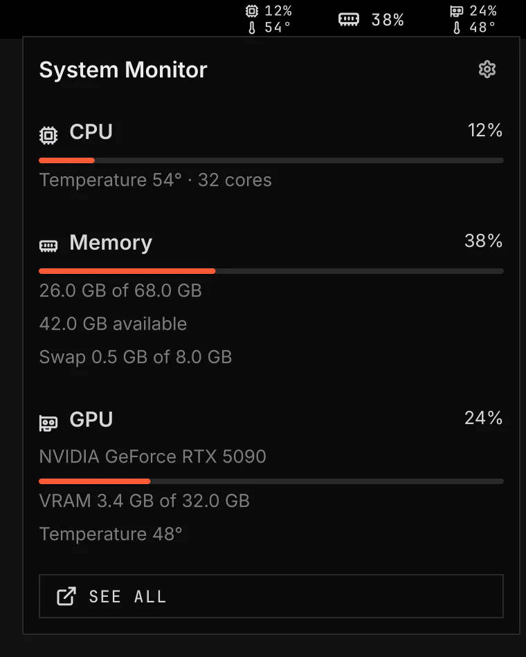

# System Monitor

System Monitor shows CPU, memory and graphics card use in the bar. Its flyout shows temperatures, memory totals and graphics memory.

## Features

- Choose the readings in the bar.
- Add CPU and graphics card temperatures.
- Show memory as a percentage or used GB.
- Open the flyout for memory, swap and graphics memory details.
- Open See all for the process list in btop.

## Setup

Open Settings, Shell & Plugins, System Monitor. Readings sets how the bar lays out and labels its readings, the refresh interval and the temperature unit. CPU, Memory and GPU each turn their bar value on or off. Graphics card, under GPU, selects the card when the computer has more than one.

If See all is missing, select Setup on the same page. Under Optional tools, select Review all missing or outdated tools to add btop for the process list.
